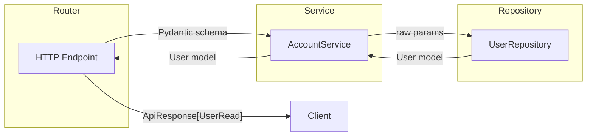
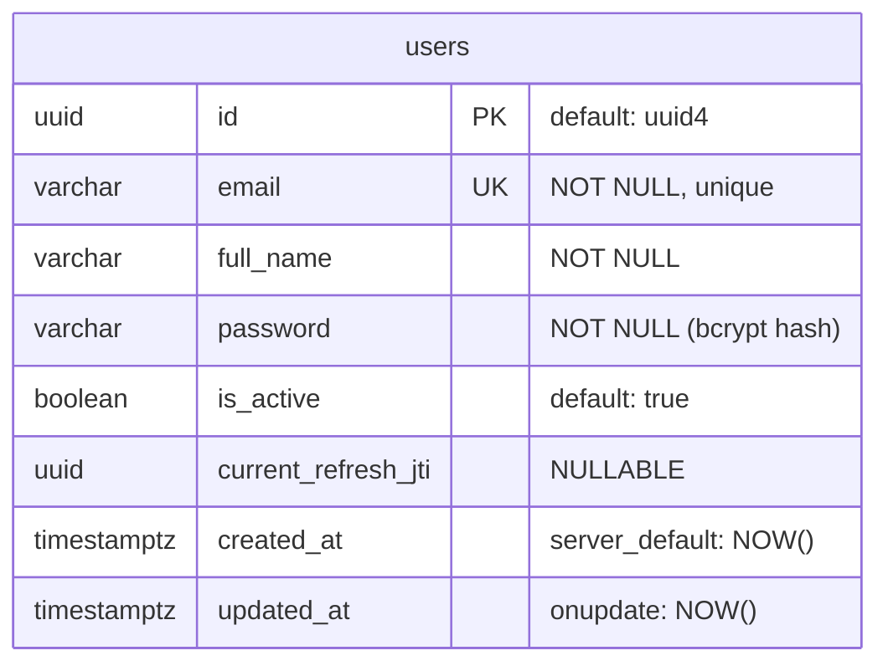
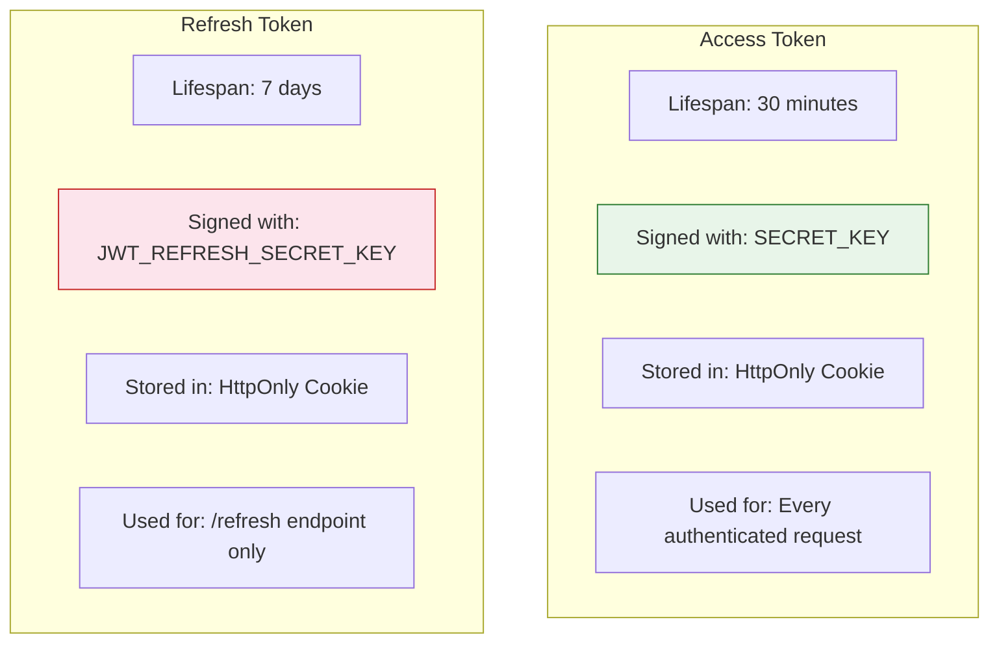
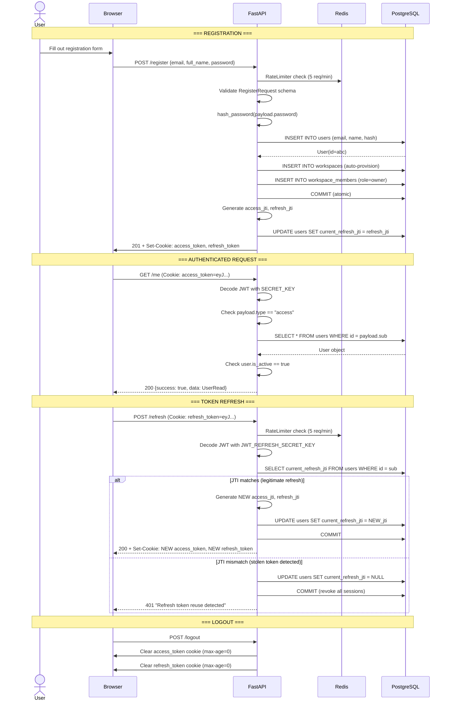
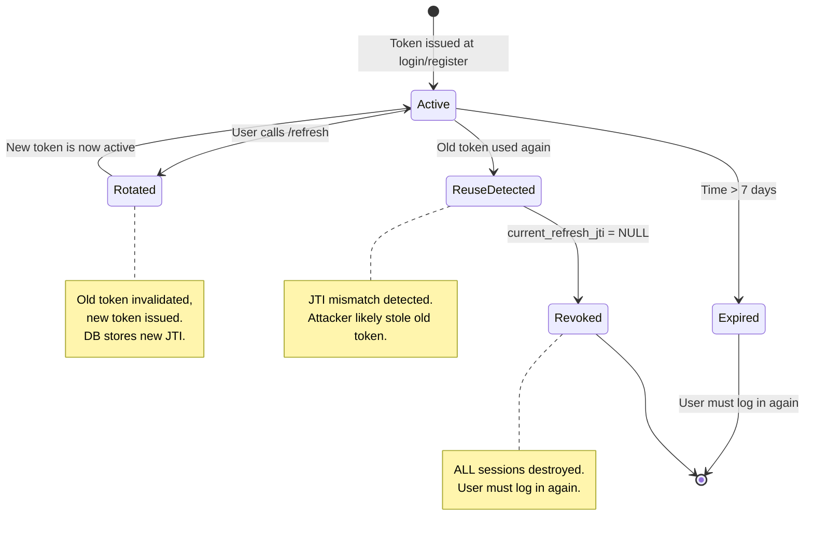
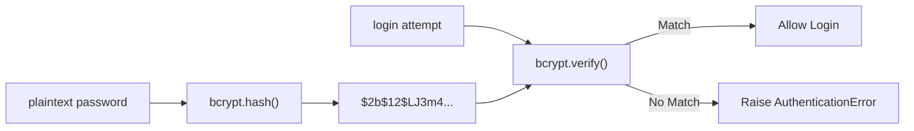
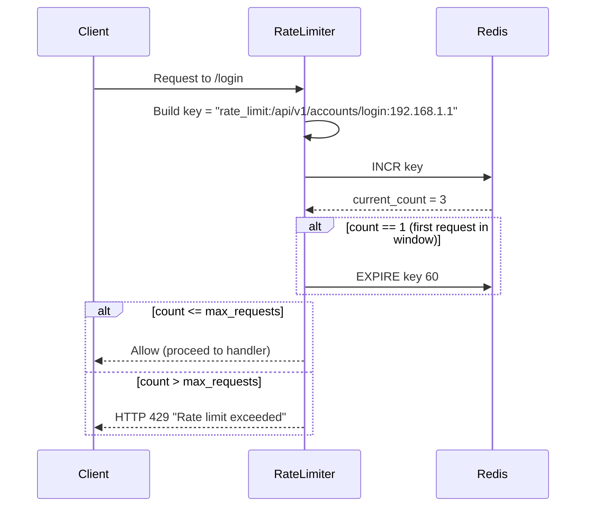
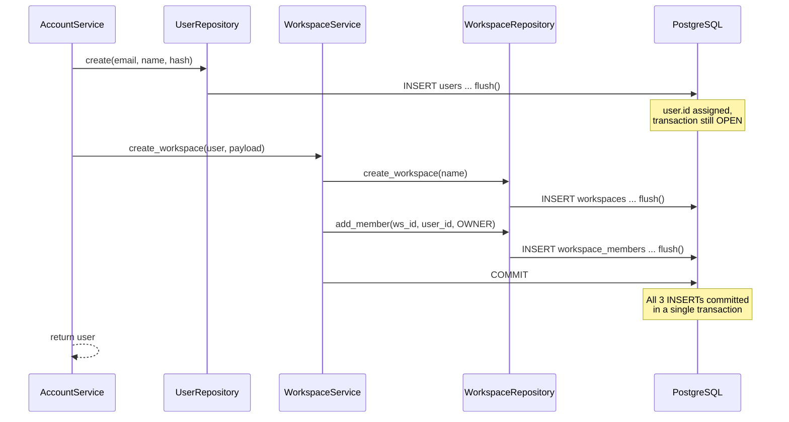

# Accounts Module — Technical Specification

> **Module Path**: `app/modules/accounts/`  
> **API Prefix**: `/api/v1/accounts`  
> **Responsibilities**: User identity, registration, authentication, session management

---

## Table of Contents

1. [Module Overview](#1-module-overview)
2. [Data Model](#2-data-model)
3. [Authentication Architecture](#3-authentication-architecture)
4. [Rate Limiting](#4-rate-limiting)
5. [API Reference](#5-api-reference)
6. [Cross-Module Orchestration](#6-cross-module-orchestration)
7. [Error Catalogue](#7-error-catalogue)

---

## 1. Module Overview

The accounts module is the identity provider for the entire system. It manages user registration, credential verification, JWT token issuance and rotation, and session lifecycle.

### Module Structure

```
app/modules/accounts/
├── models.py          # User SQLAlchemy model
├── schemas.py         # Pydantic request/response schemas
├── repository.py      # UserRepository (database queries)
├── service.py         # AccountService (business logic)
├── router.py          # HTTP endpoint definitions
└── dependencies.py    # get_current_user auth dependency
```

### Internal Data Flow



---

## 2. Data Model

### 2.1 Entity-Relationship Diagram



### 2.2 Column Specification

| Column | Type | Constraints | Description |
|--------|------|-------------|-------------|
| `id` | `UUID` | PK, default `uuid4` | Globally unique user identifier |
| `email` | `VARCHAR` | UNIQUE, NOT NULL | Normalized to lowercase on registration |
| `full_name` | `VARCHAR` | NOT NULL | Display name |
| `password` | `VARCHAR` | NOT NULL | bcrypt hash (never stored in plaintext) |
| `is_active` | `BOOLEAN` | default `true` | Soft-delete / account suspension flag |
| `current_refresh_jti` | `UUID` | NULLABLE | JTI of the currently valid refresh token. Used for rotation detection |
| `created_at` | `TIMESTAMPTZ` | NOT NULL | Set by PostgreSQL `NOW()` on insert |
| `updated_at` | `TIMESTAMPTZ` | NOT NULL | Auto-updated by PostgreSQL on every change |

### 2.3 Relationships

| Relationship | Type | Target | Cascade |
|-------------|------|--------|---------|
| `workspace_memberships` | One-to-Many | `WorkspaceMember` | `all, delete-orphan` |

When a User is deleted, all their workspace memberships are automatically removed.

---

## 3. Authentication Architecture

### 3.1 Dual-Token JWT Strategy

The system uses two separate JWT tokens to balance security and usability:



**Why separate secrets?** If an attacker compromises the access token secret (e.g., leaked in a log), they can forge access tokens that expire in 30 minutes. But they CANNOT forge refresh tokens (which use a completely different secret), limiting the blast radius.

### 3.2 Token Payload Structure

Both tokens share the same Pydantic schema (`TokenPayload`):

| Claim | Type | Description |
|-------|------|-------------|
| `sub` | `uuid.UUID` | User ID (subject) |
| `exp` | `int` | Expiration timestamp (Unix epoch) |
| `jti` | `uuid.UUID` | Unique token identifier |
| `type` | `"access" \| "refresh"` | Discriminator to prevent cross-use |
| `iat` | `datetime` | Issued-at timestamp |

### 3.3 Complete Authentication Lifecycle



### 3.4 Token Rotation & Reuse Detection (State Machine)



### 3.5 HttpOnly Cookie Security

| Cookie Attribute | Value | Purpose |
|-----------------|-------|---------|
| `httponly` | `True` | JavaScript cannot read the cookie (XSS protection) |
| `secure` | `False` (dev) / `True` (prod) | Only sent over HTTPS in production |
| `samesite` | `lax` | Prevents CSRF on cross-origin requests |
| `max-age` | 1800s (access) / 604800s (refresh) | Browser auto-deletes expired cookies |

### 3.6 Password Hashing

Passwords are hashed using **bcrypt** via the `passlib` library:



bcrypt is intentionally slow (configurable work factor, currently `$2b$12$`) to make offline brute-force attacks computationally prohibitive.

---

## 4. Rate Limiting

### 4.1 Fixed-Window Counter Algorithm

The rate limiter uses Redis to track request counts per IP per endpoint within a fixed time window.



### 4.2 Rate Limits Per Endpoint

| Endpoint | Max Requests | Window | Rationale |
|----------|-------------|--------|-----------|
| `POST /register` | 5 | 60s | Prevent mass account creation |
| `POST /login` | 10 | 60s | Prevent credential stuffing / brute force |
| `POST /refresh` | 5 | 60s | Prevent refresh token abuse |

---

## 5. API Reference

### `POST /api/v1/accounts/register`

Creates a new user account and auto-provisions a default personal workspace.

**Request**

| Field | Type | Constraints | Required |
|-------|------|-------------|----------|
| `email` | `EmailStr` | Valid email format | Yes |
| `full_name` | `str` | min: 2, max: 100 chars | Yes |
| `password` | `str` | min: 8 chars | Yes |

```json
{
  "email": "john@example.com",
  "full_name": "John Doe",
  "password": "securepassword123"
}
```

**Response** — `201 Created`

```json
{
  "success": true,
  "message": "Registration successful",
  "data": {
    "id": "550e8400-e29b-41d4-a716-446655440000",
    "email": "john@example.com",
    "full_name": "John Doe",
    "is_active": true,
    "created_at": "2026-07-23T15:00:00+00:00"
  }
}
```

**Side Effects:**
- Sets `access_token` and `refresh_token` HttpOnly cookies
- Creates a default workspace named `"John Doe's Workspace"`
- Assigns the user as `owner` of that workspace

**Error Responses:**

| Status | Condition | Message |
|--------|-----------|---------|
| 409 | Email already registered | `"A user with this email already exists."` |
| 422 | Invalid payload (e.g., password too short) | `"Request validation failed"` |
| 429 | Rate limit exceeded | `"Rate limit exceeded. Try again in 60 seconds."` |

---

### `POST /api/v1/accounts/login`

Authenticates a user with email and password, issues new tokens.

**Request**

| Field | Type | Constraints | Required |
|-------|------|-------------|----------|
| `email` | `EmailStr` | Valid email format | Yes |
| `password` | `str` | Any length | Yes |

```json
{
  "email": "john@example.com",
  "password": "securepassword123"
}
```

**Response** — `200 OK`

```json
{
  "success": true,
  "message": "Login successful",
  "data": {
    "id": "550e8400-e29b-41d4-a716-446655440000",
    "email": "john@example.com",
    "full_name": "John Doe",
    "is_active": true,
    "created_at": "2026-07-23T15:00:00+00:00"
  }
}
```

**Side Effects:**
- Sets `access_token` and `refresh_token` HttpOnly cookies
- Updates `current_refresh_jti` in the database

**Error Responses:**

| Status | Condition | Message |
|--------|-----------|---------|
| 401 | Wrong email or password | `"Invalid email or password."` |
| 401 | Account disabled | `"User account is disabled."` |
| 429 | Rate limit exceeded | `"Rate limit exceeded. Try again in 60 seconds."` |

---

### `POST /api/v1/accounts/refresh`

Issues new access and refresh tokens using the refresh token cookie. Implements token rotation.

**Request**

No JSON body. Reads `refresh_token` from HttpOnly cookie.

**Response** — `200 OK`

```json
{
  "success": true,
  "message": "Token refreshed successfully",
  "data": null
}
```

**Side Effects:**
- Invalidates the old refresh token
- Sets new `access_token` and `refresh_token` HttpOnly cookies
- Updates `current_refresh_jti` in the database

**Error Responses:**

| Status | Condition | Message |
|--------|-----------|---------|
| 401 | No refresh cookie present | `"Missing refresh token cookie."` |
| 401 | Token expired or malformed | `"Invalid or expired refresh token."` |
| 401 | Token reuse detected | `"Refresh token reuse detected. Please log in again."` |

---

### `POST /api/v1/accounts/logout`

Clears authentication cookies. No server-side session invalidation.

**Request**

No JSON body required. No authentication required.

**Response** — `200 OK`

```json
{
  "success": true,
  "message": "Logged out successfully",
  "data": null
}
```

**Side Effects:**
- Sets `access_token` cookie to empty with `max-age=0`
- Sets `refresh_token` cookie to empty with `max-age=0`

---

### `GET /api/v1/accounts/me`

Returns the profile of the currently authenticated user.

**Request**

No JSON body. Requires valid `access_token` cookie.

**Response** — `200 OK`

```json
{
  "success": true,
  "message": "User profile retrieved",
  "data": {
    "id": "550e8400-e29b-41d4-a716-446655440000",
    "email": "john@example.com",
    "full_name": "John Doe",
    "is_active": true,
    "created_at": "2026-07-23T15:00:00+00:00"
  }
}
```

**Error Responses:**

| Status | Condition | Message |
|--------|-----------|---------|
| 401 | No access cookie | `"Not authenticated."` |
| 401 | Token expired or invalid | `"Invalid or expired access token."` |
| 401 | User deleted after token was issued | `"User no longer exists."` |
| 401 | Account suspended | `"User account is disabled."` |

---

## 6. Cross-Module Orchestration

The `AccountService.register_user` method demonstrates how modules communicate while maintaining transactional integrity:



If any step fails (e.g., a duplicate email on the user insert), the entire transaction rolls back. No orphaned workspaces or workspace members are created.

---

## 7. Error Catalogue

| Error Class | HTTP Status | When Raised | Example Message |
|------------|-------------|-------------|-----------------|
| `AuthenticationError` | 401 | Invalid credentials, expired tokens, disabled accounts | `"Invalid email or password."` |
| `ConflictError` | 409 | Duplicate email on registration | `"A user with this email already exists."` |
| `ValidationError` | 422 | Pydantic schema validation failure | `"Request validation failed"` |
