# System Architecture — Technical Specification

> **Version**: 0.1.0  
> **Last Updated**: 2026-07-23  
> **System**: Document RAG System — Backend API

---

## Table of Contents

1. [System Overview](#1-system-overview)
2. [Technology Stack](#2-technology-stack)
3. [Directory Structure](#3-directory-structure)
4. [Architectural Patterns & Design Decisions](#4-architectural-patterns--design-decisions)
5. [Application Lifecycle](#5-application-lifecycle)
6. [The Request Pipeline](#6-the-request-pipeline)
7. [Dependency Injection System](#7-dependency-injection-system)
8. [Database Architecture](#8-database-architecture)
9. [Global Exception Handling](#9-global-exception-handling)
10. [Configuration Management](#10-configuration-management)
11. [API Versioning & Routing](#11-api-versioning--routing)

---

## 1. System Overview

The backend is a **Modular Monolith** — a single deployable unit whose internals are cleanly separated into domain modules. Each module owns its models, schemas, service logic, and data access layer independently. This gives us the development speed of a monolith with the clean boundaries that make future extraction into microservices trivial.

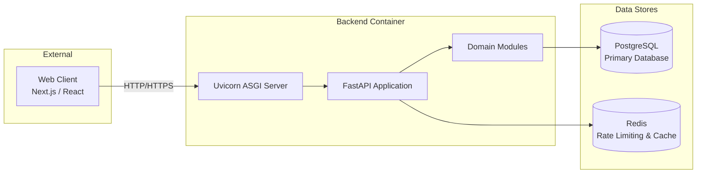

---

## 2. Technology Stack

| Component | Technology | Version | Purpose |
|-----------|-----------|---------|---------|
| **Language** | Python | 3.11 | Async-first, type-hinted |
| **Framework** | FastAPI | 0.115+ | ASGI web framework with automatic OpenAPI |
| **ORM** | SQLAlchemy | 2.0 (Async) | Declarative models with async session support |
| **Database** | PostgreSQL | 16 | Primary relational data store |
| **Cache / Rate Limit** | Redis | 7+ | Fixed-window rate limiting, future task queues |
| **Migrations** | Alembic | 1.14+ | Versioned database schema management |
| **Auth** | python-jose + passlib | — | JWT encoding/decoding + bcrypt password hashing |
| **Validation** | Pydantic | v2 | Request/response schema validation |
| **Config** | pydantic-settings | — | Type-safe env variable loading |
| **Containerization** | Docker + Compose | — | Reproducible dev/prod environments |

---

## 3. Directory Structure

```
backend/
├── app/
│   ├── main.py                        # Entrypoint (thin — delegates to setup.py)
│   ├── core/                          # Cross-cutting concerns
│   │   ├── config.py                  # Settings loaded from .env
│   │   ├── setup.py                   # Application Factory (create_app)
│   │   ├── security.py                # Password hashing, JWT creation/decoding
│   │   ├── schemas.py                 # Shared Pydantic schemas (TokenPayload)
│   │   ├── responses.py               # ApiResponse generic wrapper
│   │   ├── exceptions.py              # Domain exceptions + global handlers
│   │   ├── rate_limit.py              # Redis-backed rate limiter
│   │   └── logging.py                 # Structured logging configuration
│   ├── db/                            # Database infrastructure
│   │   ├── base.py                    # DeclarativeBase with naming conventions
│   │   ├── mixins.py                  # UUIDPrimaryKeyMixin, TimestampMixin
│   │   └── session.py                 # Async engine, session factory, get_db dependency
│   ├── api/
│   │   └── v1/
│   │       └── router.py             # Version prefix aggregator (/api/v1)
│   └── modules/
│       ├── accounts/                  # Identity & Authentication domain
│       │   ├── models.py              # User model
│       │   ├── schemas.py             # RegisterRequest, LoginRequest, UserRead
│       │   ├── repository.py          # UserRepository (DB queries)
│       │   ├── service.py             # AccountService (business logic)
│       │   ├── router.py              # HTTP endpoints
│       │   └── dependencies.py        # get_current_user auth dependency
│       └── workspaces/                # Multi-Tenancy domain
│           ├── models.py              # Workspace, WorkspaceMember, WorkspaceRole
│           ├── schemas.py             # WorkspaceCreate, InviteMemberRequest, etc.
│           ├── repository.py          # WorkspaceRepository
│           ├── service.py             # WorkspaceService
│           ├── router.py              # HTTP endpoints
│           └── dependencies.py        # RBAC dependency (require_workspace_roles)
├── migrations/                        # Alembic migration versions
├── tests/                             # Mirrors app/modules/ structure
├── docker/                            # Dockerfiles
└── pyproject.toml                     # Dependencies, pytest config
```

---

## 4. Architectural Patterns & Design Decisions

### 4.1 Pattern: Layered Architecture (Router → Service → Repository)

Every domain module is internally structured into three strictly separated layers. Each layer has a single responsibility and communicates only with its immediate neighbor.

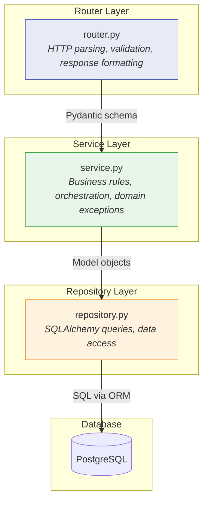

**Why this pattern?**
- The Router never touches SQLAlchemy. If we swap FastAPI for another framework, only routers change.
- The Service never knows about HTTP status codes. It raises semantic exceptions like `ConflictError`, not `HTTPException(409)`.
- The Repository never validates business rules. It simply executes queries and returns model instances.

### 4.2 Pattern: Application Factory

The `create_app()` function in `app/core/setup.py` constructs the entire FastAPI application. This pattern (borrowed from Flask) keeps `main.py` to a single line and makes the app fully configurable for testing.

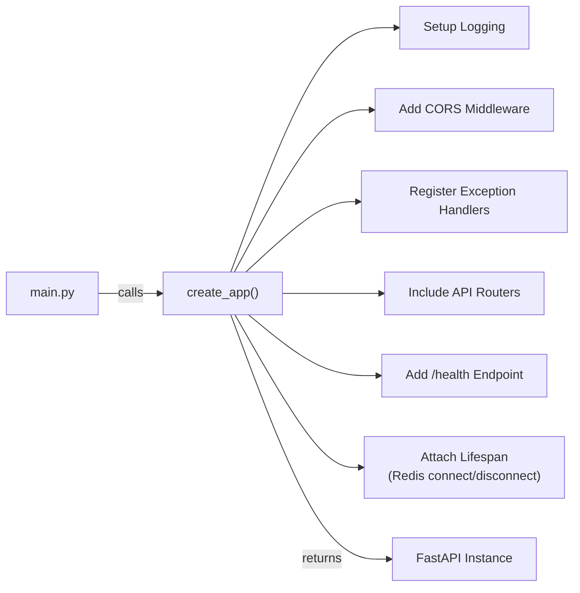

### 4.3 Pattern: Generic Response Envelope

Every API response is wrapped in `ApiResponse[T]`, a generic Pydantic model:

```python
class ApiResponse(BaseModel, Generic[T]):
    success: bool = True
    message: str | None = None
    data: T | None = None
```

This guarantees the frontend always receives a predictable JSON shape:
```json
// Success
{ "success": true, "message": "Login successful", "data": { ... } }

// Error
{ "success": false, "message": "Invalid email or password" }
```

### 4.4 Pattern: Mixin-Based Model Composition

Instead of repeating `id`, `created_at`, and `updated_at` columns across every model, we use Python's multiple inheritance to compose models from reusable mixins.

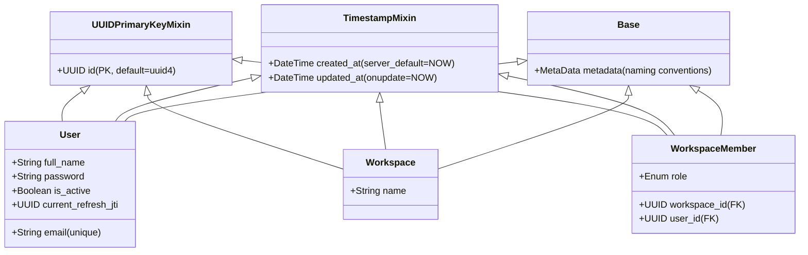

**Why server-side timestamps?** The `TimestampMixin` uses `server_default=func.now()` (PostgreSQL's `NOW()`) rather than Python's `datetime.utcnow()`. This ensures all timestamps come from the database clock, not the application server clock, which matters when running multiple app replicas.

### 4.5 Pattern: Flush vs Commit (Unit of Work)

A critical architectural decision in the Repository layer:

- **`flush()`** — Sends the SQL to PostgreSQL and assigns IDs, but does NOT finalize the transaction. The data can still be rolled back.
- **`commit()`** — Permanently writes data to disk. Called only by the Service layer after all operations succeed.

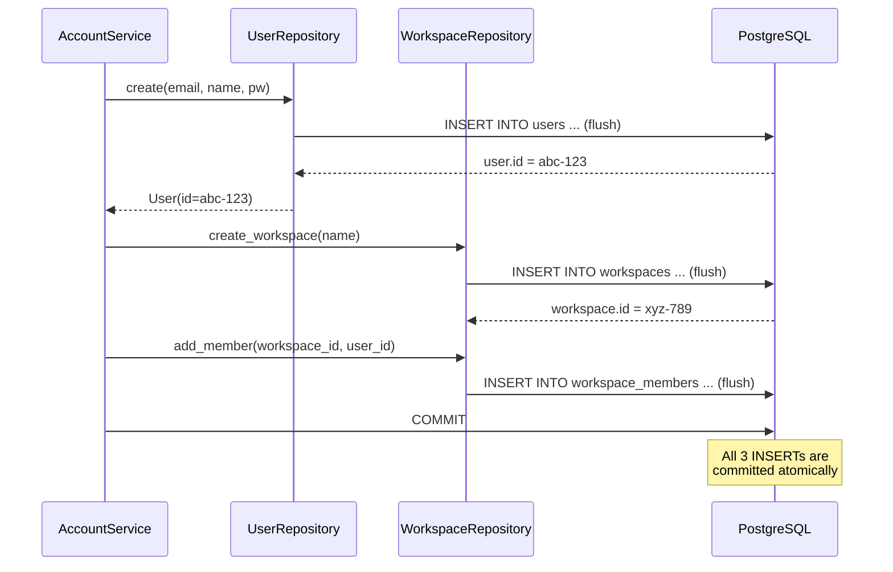

If any step fails (e.g., a duplicate email), the entire transaction rolls back — no orphaned workspaces or members are left behind.

### 4.6 Pattern: Database Naming Conventions

The `Base` class in `app/db/base.py` enforces PostgreSQL naming conventions for all auto-generated constraints:

| Constraint Type | Pattern | Example |
|----------------|---------|---------|
| Primary Key | `pk_%(table_name)s` | `pk_users` |
| Foreign Key | `fk_%(table_name)s_%(column)s_%(referred)s` | `fk_workspace_members_user_id_users` |
| Unique | `uq_%(table_name)s_%(column)s` | `uq_users_email` |
| Index | `ix_%(table_name)s_%(column)s` | `ix_workspace_members_user_id` |

This ensures Alembic migrations produce deterministic, readable constraint names across all environments.

---

## 5. Application Lifecycle

The FastAPI application follows a strict startup/shutdown lifecycle managed by an async context manager.

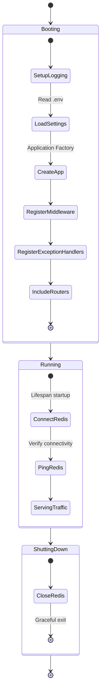

---

## 6. The Request Pipeline

Every incoming HTTP request traverses a well-defined pipeline before reaching application code and returning a response.

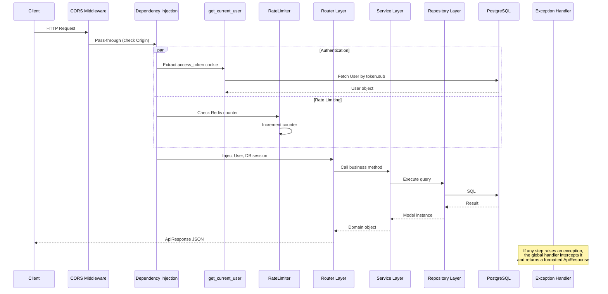

---

## 7. Dependency Injection System

FastAPI's `Depends()` mechanism is used extensively to build a composable dependency graph. Dependencies are resolved per-request and can be nested.

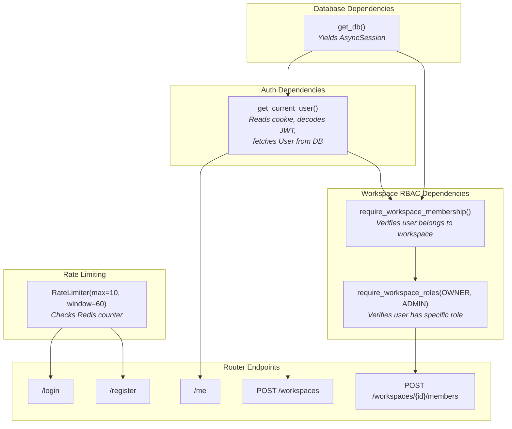

The `require_workspace_roles()` function is a **dependency factory** — a function that returns a dependency. This pattern allows passing configuration (which roles are allowed) while still participating in FastAPI's DI graph:

```python
# Usage: Only OWNER and ADMIN can invite members
member: WorkspaceMember = Depends(
    require_workspace_roles(WorkspaceRole.OWNER, WorkspaceRole.ADMIN)
)
```

---

## 8. Database Architecture

### 8.1 Full Entity-Relationship Diagram

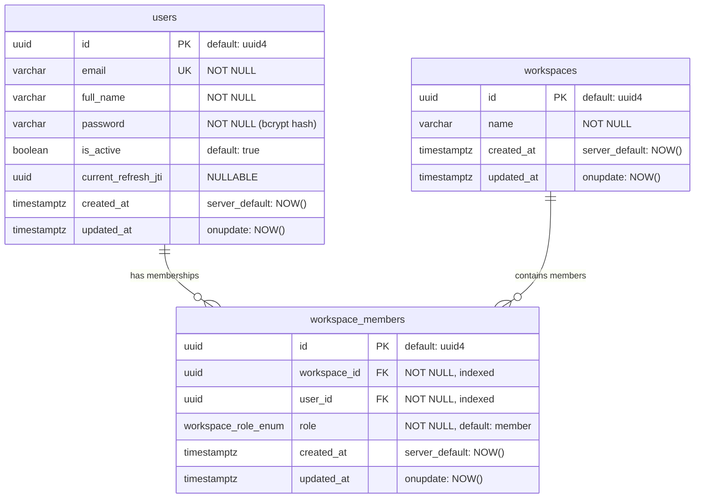

### 8.2 Connection Pool Configuration

The async engine is configured for production-grade connection management:

| Parameter | Value | Rationale |
|-----------|-------|-----------|
| `pool_size` | 10 | Maximum persistent connections in the pool |
| `max_overflow` | 20 | Extra connections allowed during traffic spikes (total: 30) |
| `pool_recycle` | 3600s | Recreate connections after 1 hour to prevent stale TCP sessions |
| `expire_on_commit` | False | Objects remain usable after `commit()` without re-querying |

### 8.3 Session Lifecycle

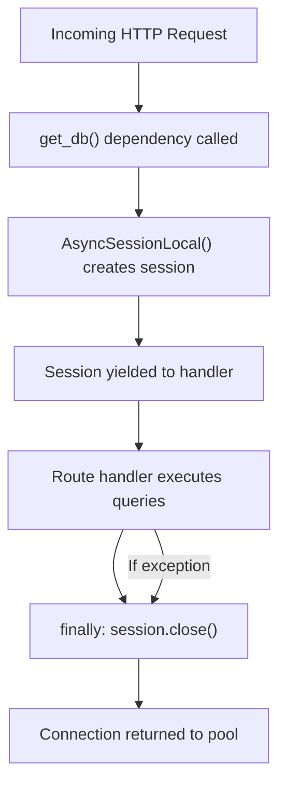

The `get_db()` generator dependency uses `try/finally` to guarantee session cleanup regardless of whether the request succeeds or raises an exception.

---

## 9. Global Exception Handling

### 9.1 Exception Class Hierarchy

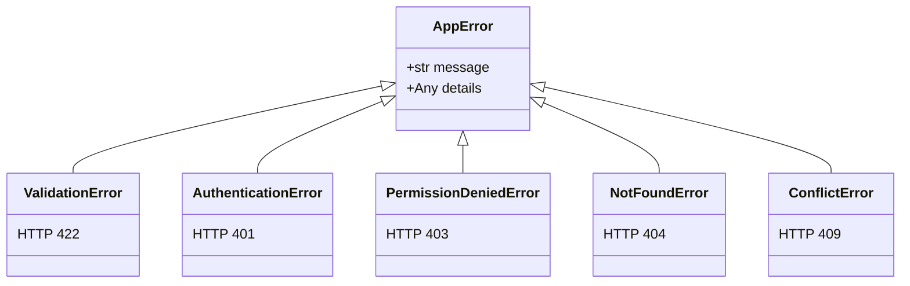

### 9.2 Handler Resolution Order

Four exception handlers are registered on the FastAPI app, checked in this priority:

1. **`AppError`** — All domain exceptions. Maps exception type to HTTP status code.
2. **`RequestValidationError`** — Pydantic schema validation failures. Returns field-level error details.
3. **`StarletteHTTPException`** — Standard HTTP errors (e.g., 404 for unknown routes).
4. **`Exception`** — Catch-all safety net. Logs the full traceback server-side but returns only `"Internal server error"` to the client to prevent information leakage.

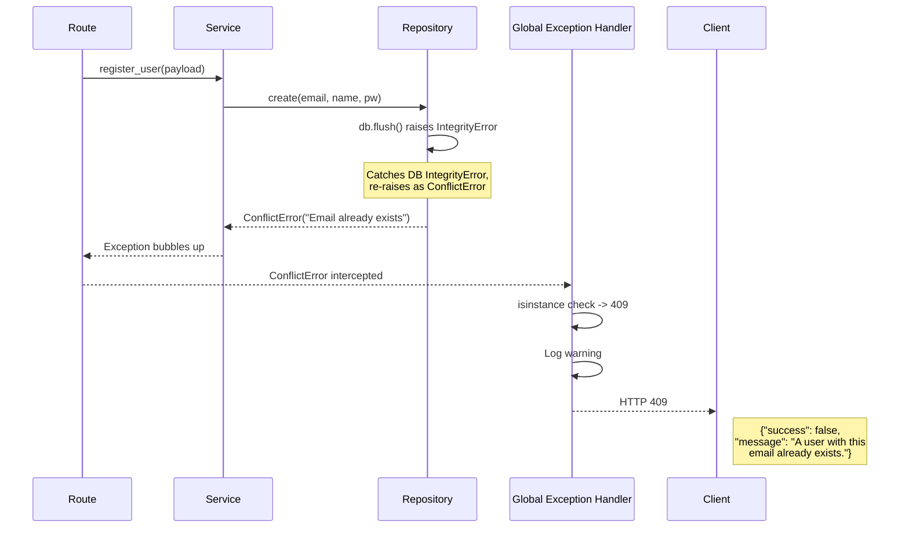

---

## 10. Configuration Management

### 10.1 Design: pydantic-settings

All configuration is centralized in `app/core/config.py` using `pydantic-settings`. This provides:
- **Type safety**: `ACCESS_TOKEN_EXPIRE_MINUTES: int = 30` — if someone sets it to `"abc"` in `.env`, the app crashes at startup with a clear error.
- **Validation**: `extra="forbid"` causes the app to fail loudly if there is a typo in an env variable name.
- **Defaults**: Every setting has a safe development default, so the app boots without manual configuration.

### 10.2 Configuration Categories

| Category | Variables | Purpose |
|----------|----------|---------|
| **Database** | `DATABASE_URL` | PostgreSQL connection string (sync format for Alembic compatibility) |
| **Redis** | `REDIS_URL` | Rate limiting and future caching |
| **JWT Auth** | `SECRET_KEY`, `JWT_REFRESH_SECRET_KEY`, `JWT_ALGORITHM`, `ACCESS_TOKEN_EXPIRE_MINUTES`, `REFRESH_TOKEN_EXPIRE_DAYS` | Dual-token authentication |
| **Cookies** | `ACCESS_COOKIE_NAME`, `REFRESH_COOKIE_NAME`, `REFRESH_COOKIE_SECURE`, `REFRESH_COOKIE_SAMESITE` | HttpOnly cookie behavior |
| **Storage** | `STORAGE_PATH` | File upload directory |
| **Celery** | `CELERY_BROKER_URL`, `CELERY_RESULT_BACKEND` | Background task processing (future) |
| **AI/ML** | `EMBEDDING_MODEL`, `EMBEDDING_DIMENSION`, `DEFAULT_LLM_PROVIDER`, `OPENAI_API_KEY`, `GEMINI_API_KEY`, `OLLAMA_BASE_URL` | RAG pipeline configuration (future) |

### 10.3 Factory Pattern for Testability

```python
def get_settings() -> Settings:
    return Settings()
```

Settings are accessed through a factory function, not a global singleton. This allows tests to monkeypatch `get_settings` to inject test-specific configurations (like a separate test database URL).

---

## 11. API Versioning & Routing

### 11.1 Version Prefix Architecture

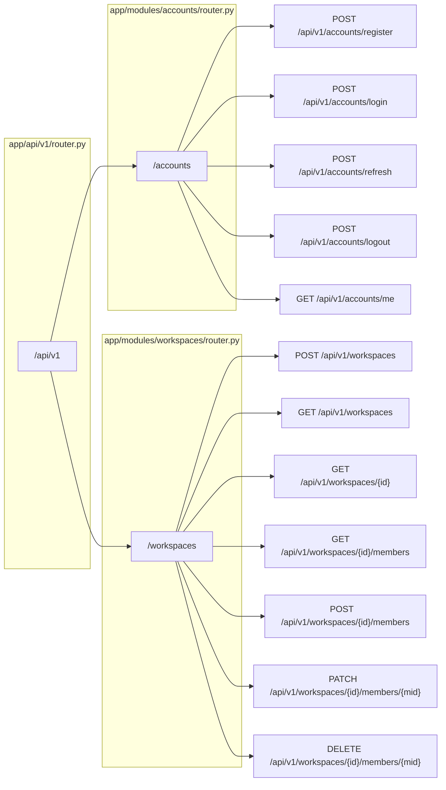

The version prefix (`/api/v1`) is applied at the aggregator level in `api/v1/router.py`. Each module defines its own prefix (`/accounts`, `/workspaces`). When API v2 is needed, a new `api/v2/router.py` can be created without touching existing module code.

### 11.2 Health Check

A standalone `/health` endpoint is registered directly on the app (outside of versioned routing) to provide infrastructure-level monitoring:

```json
// GET /health
{
  "status": "ok",        // or "degraded"
  "service": "docrag-api",
  "redis": "connected",
  "database": "connected"
}
```

Docker Compose and load balancers use this endpoint to determine container readiness.
