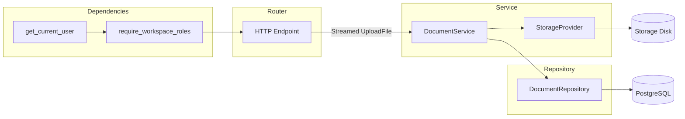
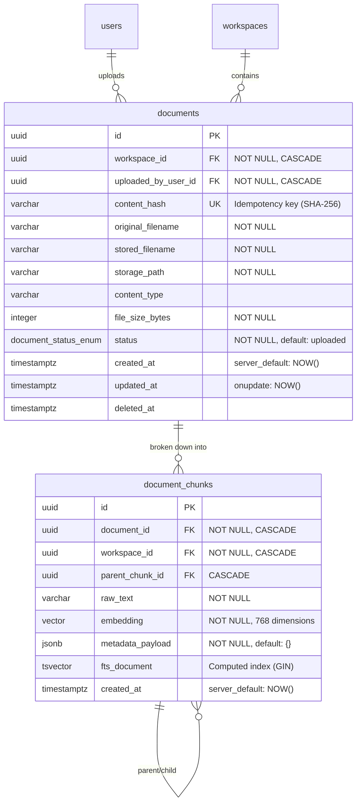
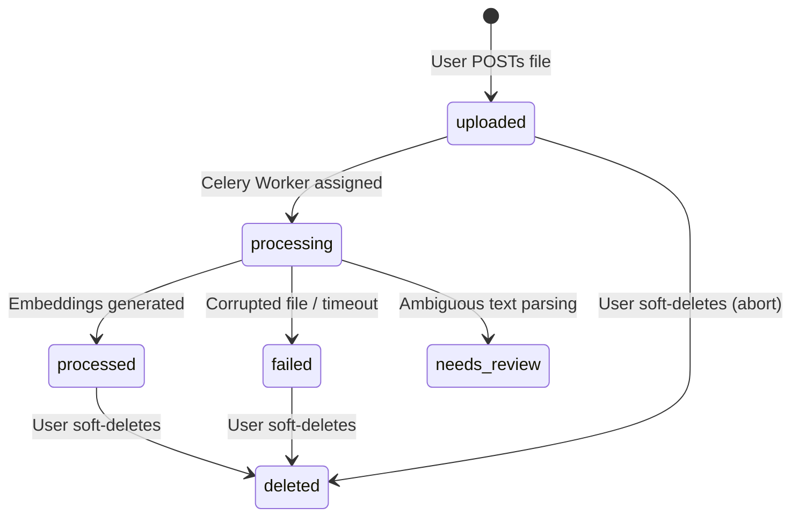
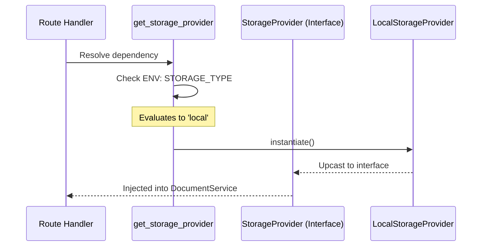
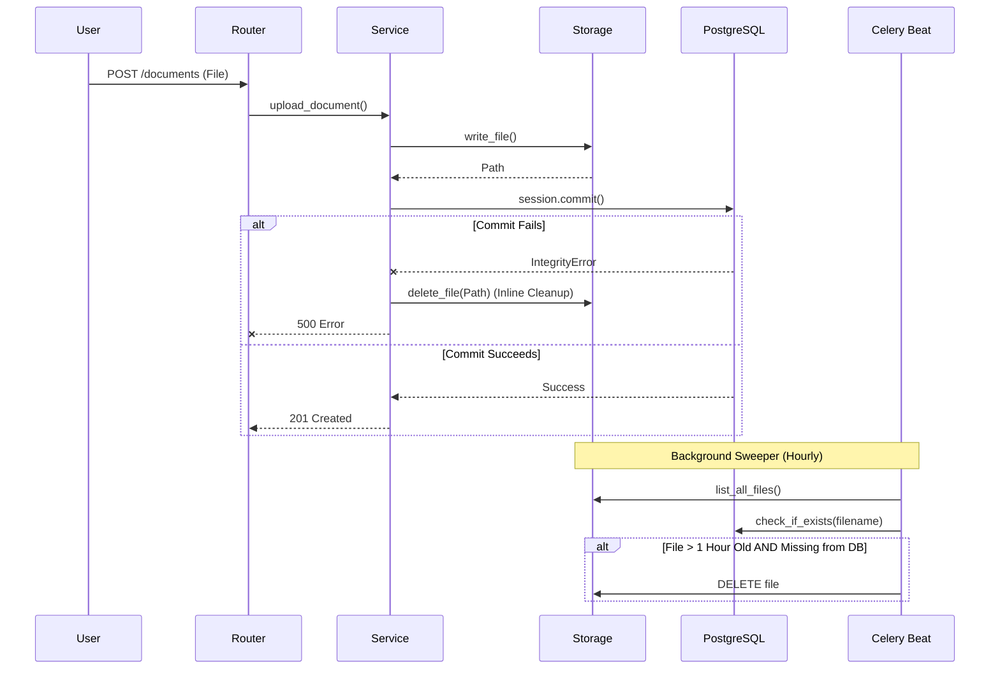

# Documents Module — Technical Specification

> **Module Path**: `app/modules/documents/`  
> **API Prefix**: `/api/v1/workspaces/{workspace_id}/documents`  
> **Responsibilities**: File uploads, abstract storage management, validation constraints, soft-deletion semantics, automated disk cleanup, and document lifecycle state-machine.

---

## Table of Contents

1. [Module Overview](#1-module-overview)
2. [Data Model](#2-data-model)
3. [Storage Strategy Architecture](#3-storage-strategy-architecture)
4. [File Constraints & Edge-Cases](#4-file-constraints--edge-cases)
5. [Role-Based Access Control (RBAC)](#5-role-based-access-control-rbac)
6. [Upload & Reconciliation Workflows](#6-upload--reconciliation-workflows)
7. [API Reference](#7-api-reference)
8. [Error Catalogue](#8-error-catalogue)

---

## 1. Module Overview

The Documents module serves as the primary ingestion gateway. Before any file can be embedded, chunked, or analyzed, it must pass through this module. 

### Module Structure

```
app/modules/documents/
├── models.py          # Document, DocumentChunk, DocumentStatus
├── schemas.py         # Request/response Pydantic schemas
├── repository.py      # Workspace-isolated DB queries and filtering
├── service.py         # Business logic, boundary checks, and Storage interop
├── router.py          # HTTP endpoint definitions
├── storage.py         # StorageProvider abstractions (Local/Cloud Strategy)
└── tasks.py           # Celery workers (Orphaned file cleanup)
```

### Internal Data Flow



---

## 2. Data Model

### 2.1 Entity-Relationship Diagram



### 2.2 Table Specifications

**`documents`**

| Column | Type | Constraints | Description |
|--------|------|-------------|-------------|
| `id` | `UUID` | PK, default `uuid4` | Unique document identifier |
| `workspace_id` | `UUID` | FK → `workspaces.id` | Isolated scoping boundary |
| `uploaded_by_user_id`| `UUID` | FK → `users.id` | Audit trail for uploads |
| `content_hash` | `VARCHAR(64)`| UNIQUE, nullable | Dedup key to prevent double-processing |
| `original_filename`| `VARCHAR(255)`| NOT NULL | Display name |
| `stored_filename`| `VARCHAR(255)`| NOT NULL | Disk file name (`uuid4.ext`) |
| `storage_path` | `VARCHAR(1024)`| NOT NULL | Locator string for the `StorageProvider` |
| `content_type` | `VARCHAR(255)`| nullable | Upload MIME type |
| `file_size_bytes`| `INTEGER`| NOT NULL | Raw byte count |
| `status` | `document_status_enum`| NOT NULL | Current state machine stage |
| `deleted_at` | `TIMESTAMPTZ`| nullable | Soft-deletion marker |

**`document_chunks`**

| Column | Type | Constraints | Description |
|--------|------|-------------|-------------|
| `embedding` | `VECTOR(768)` | NOT NULL | pgvector HNSW-indexed column (cosine ops) |
| `fts_document` | `TSVECTOR` | Computed, Persisted | Concatenates `raw_text` for GIN indexing |
| `metadata_payload`| `JSONB` | GIN indexed | Extracted tables, links, page numbers |
| `parent_chunk_id` | `UUID` | Indexed | Hierarchical chunks (e.g., small windows summarizing large sections) |

### 2.3 Document Lifecycle (State Machine)

Documents strictly transition through these states to prevent race conditions across distributed Celery workers.



---

## 3. Storage Strategy Architecture

Because storage requirements change as the application scales (Local Disk → S3 → Azure Blob), file storage is managed via a Strategy pattern.

### 3.1 Dependency Injection Chain



### 3.2 Provider Behaviors

- **Workspace Isolation:** `LocalStorageProvider` forces files into `/storage/{workspace_id}/documents/`. This makes workspace exportation or hard-deletion a single `O(1)` folder operation rather than an `O(N)` DB iteration.
- **Byte Streaming:** The provider uses `shutil.copyfileobj(file.file, buffer)` to prevent massive 20MB files from being loaded directly into RAM, ensuring memory safety.

---

## 4. File Constraints & Edge-Cases

To prevent systemic abuse, the module intercepts uploads based on strict config values from `app.core.config`:

| Constraint | Configuration | Enforcement Layer | Action / Error |
|------------|---------------|-------------------|----------------|
| **Max Size** | `MAX_UPLOAD_SIZE_MB=25` | `service.py` | Before disk write. Throws `413 Request Entity Too Large` |
| **Allowed Types** | `ALLOWED_CONTENT_TYPES` | `service.py` | Throws `415 Unsupported Media Type` if not PDF/DOCX/TXT/CSV |
| **Empty File** | `file.size == 0` | `service.py` | Throws `400 Bad Request` |
| **No Filename**| `file.filename == ""`| `service.py` | Throws `400 Bad Request` |

---

## 5. Role-Based Access Control (RBAC)

The `Router` explicitly inherits the RBAC models created in the Workspaces module.

| Action | Endpoint | Owner | Admin | Member | Viewer |
|--------|----------|:-----:|:-----:|:------:|:------:|
| Upload Document | `POST /` | ✅ | ✅ | ✅ | ❌ |
| List Documents | `GET /` | ✅ | ✅ | ✅ | ✅ |
| Get Document Details | `GET /{id}` | ✅ | ✅ | ✅ | ✅ |
| Download Physical File| `GET /{id}/download`| ✅ | ✅ | ✅ | ✅ |
| Soft Delete | `DELETE /{id}` | ✅ | ✅ | ❌ | ❌ |

---

## 6. Upload & Reconciliation Workflows

### 6.1 The Atomicity Problem
When a user uploads a file, two distinct systems must be updated:
1. The **File System** (StorageProvider writes bytes to disk).
2. The **PostgreSQL Database** (Repository commits the row).

If the PostgreSQL transaction fails (e.g. database timeout), the physical file is silently orphaned on disk, causing a permanent memory leak.

### 6.2 The Dual-Cleanup Strategy



**Why the 1-hour grace period?**
If the Celery worker ran immediately, it might delete a 20MB file that is currently mid-upload (written to disk, but DB transaction hasn't finalized). The grace period protects live traffic.

### 6.3 Soft Deletion Invariant

When `DELETE /{id}` is called:
1. Database record `deleted_at = NOW()`, `status = deleted`.
2. Physical file **REMAINS ON DISK**.
3. File is hidden from all `GET` queries.

*Reasoning: Legal auditing and compliance require retaining original artifacts. Hard deletion is reserved for an explicit Admin-only sweeping operation in the future.*

---

## 7. API Reference

All requests must include the JWT `access_token` cookie.

### `POST /api/v1/workspaces/{workspace_id}/documents`

Uploads a new document into the workspace. 

**Request:** `multipart/form-data`
| Field | Type | Description |
|-------|------|-------------|
| `file`| `Binary`| Maximum 25MB. PDF, DOCX, TXT, CSV. |

**Response — `201 Created`**
```json
{
  "success": true,
  "message": "Document uploaded successfully",
  "data": {
    "id": "e06e4ec4-2b80-4185-87c1-02836d314e29",
    "workspace_id": "f47ac10b-58cc-4372-a567-0e02b2c3d479",
    "uploaded_by_user_id": "550e8400-e29b-41d4-a716-446655440000",
    "original_filename": "Quarterly_Report_2026.pdf",
    "content_type": "application/pdf",
    "file_size_bytes": 450123,
    "status": "uploaded",
    "page_count": null,
    "chunk_count": null,
    "created_at": "2026-07-24T10:00:00+00:00",
    "updated_at": "2026-07-24T10:00:00+00:00"
  }
}
```

---

### `GET /api/v1/workspaces/{workspace_id}/documents`

Lists all active documents in the workspace. Automatically filters out soft-deleted files. Ordered by `created_at DESC` (newest first).

**Query Parameters:**
| Parameter | Type | Default | Description |
|-----------|------|---------|-------------|
| `limit` | `int` | `50` | Result limit (max 100) |
| `offset` | `int` | `0` | Result offset |

**Response — `200 OK`**
```json
{
  "success": true,
  "message": "Documents retrieved successfully",
  "data": [
    {
      "id": "e06e4ec4-...",
      "workspace_id": "f47ac10b-...",
      "uploaded_by_user_id": "550e8400-...",
      "original_filename": "Quarterly_Report_2026.pdf",
      "content_type": "application/pdf",
      "file_size_bytes": 450123,
      "status": "uploaded",
      "created_at": "2026-07-24T10:00:00+00:00",
      "updated_at": "2026-07-24T10:00:00+00:00"
    }
  ]
}
```

---

### `GET /api/v1/workspaces/{workspace_id}/documents/{document_id}/download`

Returns the raw binary stream of the document. Sets `Content-Disposition` so browsers can download it.

**Response — `200 OK`**
- Headers: `Content-Type: application/pdf`, `Content-Disposition: attachment; filename="Quarterly_Report_2026.pdf"`
- Body: `[Raw Binary Stream]`

---

### `DELETE /api/v1/workspaces/{workspace_id}/documents/{document_id}`

Soft-deletes a document. Requires Owner or Admin role.

**Response — `204 No Content`**
*(No body)*

---

## 8. Error Catalogue

| Error Class | HTTP Status | When Raised | Example Message |
|------------|-------------|-------------|-----------------|
| `HTTPException` | 400 | Missing filename or 0 bytes | `"No filename provided"` / `"File is empty"` |
| `PermissionDeniedError`| 403 | Non-member access | `"You do not have access to this workspace"` |
| `PermissionDeniedError`| 403 | Viewer attempting upload/delete | `"Required one of: owner, admin, member"` |
| `NotFoundError` | 404 | Bad Document ID or cross-workspace fetch | `"Document not found"` |
| `NotFoundError` | 404 | Soft-deleted document accessed | `"Document not found"` |
| `HTTPException` | 413 | Upload exceeds config limit | `"File exceeds max size of 25MB"` |
| `HTTPException` | 415 | File extension/MIME not in allow-list | `"Unsupported content type: application/x-sh"` |
| `SQLAlchemyError` | 500 | Database transaction fails post-upload | *(Generic 500, but triggers Storage inline cleanup)* |
