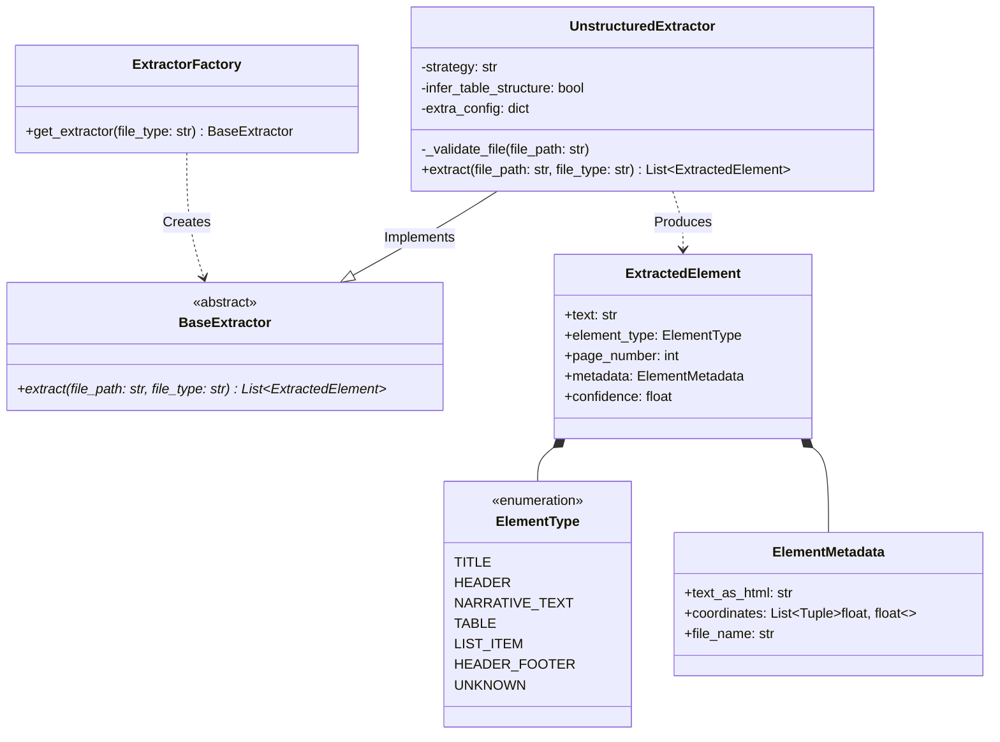
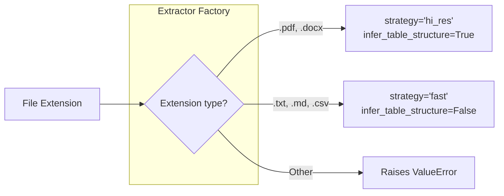
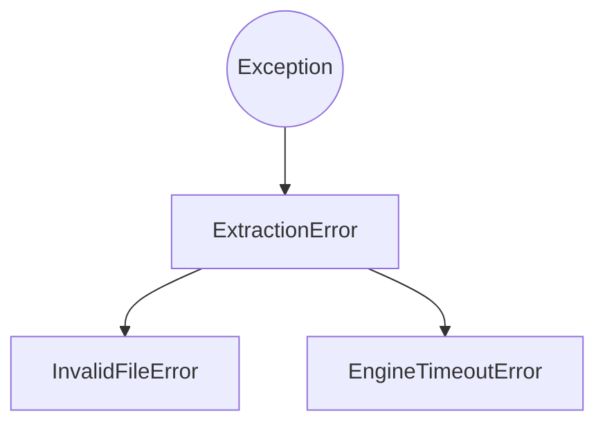

# Extraction Engine — Technical Specification

> **Module Path**: `app/modules/documents/extraction/`  
> **Responsibilities**: Parsing unstructured physical files (PDFs, text, Word docs, CSVs) into normalized, highly structured JSON elements. Handles CPU-bound vision/parsing tasks asynchronously with aggressive timeout protection and robust error isolation.

---

## Table of Contents

1. [Module Overview](#1-module-overview)
2. [Component Architecture (Class Diagram)](#2-component-architecture-class-diagram)
3. [Extraction Workflow (Sequence Diagram)](#3-extraction-workflow-sequence-diagram)
4. [Data Contracts & Schemas](#4-data-contracts--schemas)
5. [Extraction Strategies & Factory](#5-extraction-strategies--factory)
6. [Concurrency & Resilience Model](#6-concurrency--resilience-model)
7. [Error Handling & Edge Cases](#7-error-handling--edge-cases)

---

## 1. Module Overview

The Extraction Engine is a critical sub-module of the Documents domain. It acts as the bridge between raw binary files (stored on disk/cloud) and the semantic chunking engine. Before any Retrieval-Augmented Generation (RAG) can occur, documents must be structurally analyzed.

The engine is strictly responsible for:
- Layout analysis and optical character recognition (OCR).
- Structural element classification (e.g., distinguishing a "Header" from "Narrative Text" or "Table").
- Normalizing disparate document formats into a single unified JSON schema.

---

## 2. Component Architecture (Class Diagram)

The engine strictly adheres to the **Strategy** and **Factory** design patterns. This decouples the Celery worker (which coordinates the pipeline) from the specific implementations of the parsing engines.

---

## 3. Extraction Workflow (Sequence Diagram)

When a document enters the extraction phase, the system goes through a rigorous multi-step validation, routing, and processing pipeline.

```mermaid
sequenceDiagram
    participant Worker as Celery Worker
    participant Factory as ExtractorFactory
    participant Extractor as UnstructuredExtractor
    participant Thread as ThreadPoolExecutor
    participant Engine as unstructured.partition

    Worker->>Factory: get_extractor(file_type=".pdf")
    Factory-->>Worker: UnstructuredExtractor(strategy="hi_res")
    
    Worker->>Extractor: await extract(file_path, file_type)
    
    rect rgb(30, 30, 40)
        Note over Extractor: 1. Physical Validation
        Extractor->>Extractor: _validate_file()
        alt File Missing/Empty/Locked
            Extractor-->>Worker: raises InvalidFileError
        end
    end
    
    rect rgb(30, 40, 30)
        Note over Extractor,Engine: 2. Async Execution Wrapper
        Extractor->>Thread: Submit partition() task
        Thread->>Engine: partition(filename, strategy="hi_res")
        
        alt Exceeds 300 seconds
            Extractor-->>Worker: raises EngineTimeoutError
        else General Crash
            Engine-->>Thread: Exception
            Thread-->>Extractor: Exception
            Extractor-->>Worker: raises ExtractionError
        else Success
            Engine-->>Thread: Raw Unstructured Elements
            Thread-->>Extractor: Raw Unstructured Elements
        end
    end
    
    rect rgb(40, 30, 30)
        Note over Extractor: 3. Schema Normalization
        loop Over Raw Elements
            Extractor->>Extractor: Map Category to ElementType
            Extractor->>Extractor: Extract text_as_html (if TABLE)
            Extractor->>Extractor: Validate via ExtractedElement (Pydantic)
        end
    end
    
    Extractor-->>Worker: List[ExtractedElement]
```

---

## 4. Data Contracts & Schemas

To insulate the downstream LLM processing from the noise of specific parsing engines (like `unstructured`), the engine strictly normalizes all outputs into the `ExtractedElement` schema via Pydantic.

### `ElementType` Mapping & Fallback Strategy

The `unstructured` library emits dozens of granular layout categories. We intentionally collapse these down to 7 core semantic types using a safe fallback mechanism (`_missing_`). 

| Raw Engine Type (Unstructured) | Normalized `ElementType` | Rationale |
|--------------------------------|--------------------------|-----------|
| `Title`                        | `TITLE`                  | Crucial for semantic chunking hierarchy. |
| `UncategorizedText`            | `NARRATIVE_TEXT`         | Standard body text. |
| `CompositeElement`             | `NARRATIVE_TEXT`         | Grouped text blocks are treated as narrative. |
| `EmailAddress`                 | `NARRATIVE_TEXT`         | Inline emails are folded into standard text. |
| `Table`                        | `TABLE`                  | Isolated to trigger specialized HTML table chunking. |
| `ListItem`                     | `LIST_ITEM`              | Isolated to prevent breaking sequential instructions. |
| `Header` / `Footer`            | `HEADER_FOOTER`          | Often filtered out downstream to reduce noise. |
| *Any other unrecognized string*| `UNKNOWN` (Fallback)     | Graceful degradation instead of crashing the pipeline. |

---

## 5. Extraction Strategies & Factory

The `ExtractorFactory` acts as the traffic controller, dynamically configuring the underlying parsing strategy based on the file extension.

### Factory Routing Logic

**Why different strategies?**
1. **`hi_res`**: Required for complex PDFs/DOCX. Uses a heavy vision model (e.g., YOLOX) to identify layouts and perform OCR. Slower but highly accurate. Table structure inference is turned ON to grab `<table>` HTML formats.
2. **`fast`**: Used for native text files. Bypasses OCR completely. Instantly parses the text using standard regex/string operations.

---

## 6. Concurrency & Resilience Model

Because vision-based parsing (`hi_res` strategy) is heavily CPU-bound and natively synchronous, running it directly inside an `async` Celery task loop would block the entire event loop, starving other coroutines.

### The Threading & Timeout Architecture

1. **Thread Pool Offloading**: The heavy `unstructured.partition` operation is delegated to a dedicated `ThreadPoolExecutor(max_workers=1)`.
2. **Async Yielding**: The main asyncio loop is yielded back using `loop.run_in_executor()`.
3. **Aggressive Timeout Constraints**: The thread execution is wrapped in `asyncio.wait_for()`, enforcing a hard **300-second (5-minute) timeout**.
4. **Ghost Process Prevention**: If a corrupted PDF causes the underlying `unstructured` engine to infinite-loop or hang (a common failure mode with malformed PDFs), the `wait_for` constraint will aggressively sever the pipeline and throw an `EngineTimeoutError`.

---

## 7. Error Handling & Edge Cases

The module implements strict exception isolation. These exceptions do *not* inherit from the global HTTP `AppError`, as they are intended exclusively for background worker consumption.

- **`ExtractionError`**: The base class for the module. General parsing crashes (e.g., out of memory, vision model failures) are wrapped in this.
- **`InvalidFileError`**: Raised *before* engine allocation if the file payload is physically missing, zero-byte, or lacking read permissions. Protects against "ghost uploads" or storage sync issues.
- **`EngineTimeoutError`**: Raised when the 300-second execution window is breached. 

**Downstream Impact**: When the Celery pipeline catches any of these errors, it halts the pipeline, logs the failure, and updates the `Document` database entity status to `FAILED_PROCESSING`.
