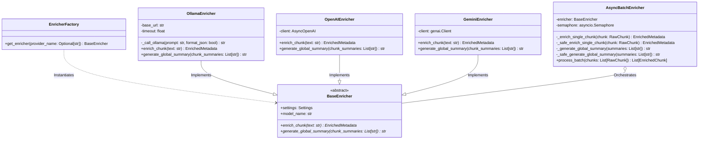

# LLM Enrichment Engine (Map-Reduce) — Technical Specification

> **Module Path**: `app/modules/documents/enrichment/`  
> **Responsibilities**: Enhancing raw document chunks with semantic metadata (summaries, keywords) and generating document-level global summaries. Orchestrates concurrent API calls to LLM providers using a resilient, rate-limited Map-Reduce pipeline.

---

## Table of Contents

1. [Module Overview & Rationale](#1-module-overview--rationale)
2. [Component Architecture (Class Diagram)](#2-component-architecture-class-diagram)
3. [Map-Reduce Workflow (Sequence Diagram)](#3-map-reduce-workflow-sequence-diagram)
4. [Data Contracts & Schemas](#4-data-contracts--schemas)
5. [LLM Provider Factory](#5-llm-provider-factory)
6. [Concurrency, Throttling & Resilience Model](#6-concurrency-throttling--resilience-model)
7. [Error Catalogue & Edge Cases](#7-error-catalogue--edge-cases)
8. [Performance & Tuning Considerations](#8-performance--tuning-considerations)

---

## 1. Module Overview & Rationale

The LLM Enrichment Engine is the intelligent core of the ingestion pipeline. It takes the raw, flat chunks generated by the Chunking/Aggregation module and enriches them using Large Language Models (LLMs). 

### Why is Enrichment Necessary?
Standard Retrieval-Augmented Generation (RAG) pipelines often suffer from two major flaws:
1. **The "Lost in the Middle" Problem**: When retrieving small chunks of text (e.g., "The rate increased by 5%"), the chunk itself lacks the broader context (e.g., "What rate? For what year?"). If embedded as-is, vector similarity search will fail to match semantic queries effectively.
2. **Sparse Retrieval Limitations**: Keyword search (BM25/Full-Text Search) relies on exact matches. If a chunk uses the word "automobile" but the user searches for "car", keyword search fails.

### The Solution: Map-Reduce Contextualization
The engine solves these problems using a two-phase **Map-Reduce** pattern:
- **Map Phase**: Independently map each raw chunk to an LLM to extract a localized summary, a list of semantic keywords, and an inferred category. This expands the chunk's vocabulary, solving the sparse retrieval limitation.
- **Reduce Phase**: Aggregate all the localized summaries from the Map phase into a single cohesive document-level "Global Summary".
- **Merge Phase**: Prepend this Global Summary to the text of every individual chunk before embedding it, ensuring every vector carries the context of the entire document.

---

## 2. Component Architecture (Class Diagram)

The module employs a **Factory** pattern combined with the **Strategy** pattern to abstract away vendor-specific LLM SDKs (OpenAI, Gemini, Ollama) from the core business logic.



### Architectural Decisions
- **Isolation of Dependencies**: The `AsyncBatchEnricher` has zero knowledge of API keys, HTTP clients, or vendor SDKs. It only knows about `BaseEnricher`.
- **Stateless Operation**: The enrichers hold configuration state but no document state, allowing them to be reused across multiple celery worker executions without cross-contamination.

---

## 3. Map-Reduce Workflow (Sequence Diagram)

When a batch of chunks enters the Enrichment Engine via the Celery Worker, it orchestrates multiple concurrent outbound network requests while adhering strictly to rate limits and retry policies.

```mermaid
sequenceDiagram
    participant Worker as Celery Task
    participant Orchestrator as AsyncBatchEnricher
    participant Factory as EnricherFactory
    participant LLM as Provider (Ollama/OpenAI)
    
    Worker->>Orchestrator: process_batch(List[RawChunk])
    Orchestrator->>Factory: get_enricher(provider)
    Factory-->>Orchestrator: LLM Client Instance
    
    rect rgb(30, 40, 30)
        Note over Orchestrator,LLM: 3.1 MAP PHASE (Concurrent & Semaphored)
        loop For each chunk (Max 5 concurrent)
            Orchestrator->>LLM: enrich_chunk(raw_text)
            
            alt Network Error / Timeout / 429
                LLM--xOrchestrator: Exception
                Note over Orchestrator: Tenacity Exponential Backoff (Wait 2-10s)
                Orchestrator->>LLM: Retry enrich_chunk(raw_text)
            else Success
                LLM-->>Orchestrator: JSON Response
                Orchestrator->>Orchestrator: Parse to EnrichedMetadata
            else Complete Failure (After 3 retries)
                LLM--xOrchestrator: Exception
                Orchestrator->>Orchestrator: Fallback to dummy metadata
            end
        end
    end
    
    rect rgb(30, 30, 40)
        Note over Orchestrator,LLM: 3.2 REDUCE PHASE (Synthesis)
        Orchestrator->>Orchestrator: Aggregate valid localized summaries
        Orchestrator->>LLM: generate_global_summary(combined_summaries)
        
        alt Success
            LLM-->>Orchestrator: Global Summary (String)
        else Failure
            LLM--xOrchestrator: Exception
            Orchestrator->>Orchestrator: Fallback to default string
        end
    end
    
    rect rgb(40, 30, 30)
        Note over Orchestrator: 3.3 MERGE PHASE (Finalization)
        loop For each chunk
            Orchestrator->>Orchestrator: Prepend Global Summary to contextualized_text
            Orchestrator->>Orchestrator: Merge EnrichedMetadata to chunk.metadata dict
            Orchestrator->>Orchestrator: Instantiate EnrichedChunk
        end
    end
    
    Orchestrator-->>Worker: List[EnrichedChunk]
```



---

## 4. Data Contracts & Schemas

To ensure strict predictability downstream (especially during database insertion), the LLMs are forced (via JSON formatting constraints or system prompts) to adhere to the `EnrichedMetadata` contract.

### 4.1 Schema Definitions

**`EnrichedMetadata` (Pydantic)**
```python
class EnrichedMetadata(BaseModel):
    summary: str = Field(..., description="A localized, chunk-specific summary.")
    keywords: List[str] = Field(..., description="Extract entities, keywords, and topics.")
    refined_category: Optional[str] = Field(None, description="Inferred category of the content.")
```

**`EnrichedChunk` (Pydantic)**
```python
class EnrichedChunk(RawChunk):
    """
    Extends RawChunk. The contextualized_text will be updated to include the 
    global summary. The metadata dictionary will contain the EnrichedMetadata fields.
    """
    metadata: dict = Field(default_factory=dict)
```

### 4.2 Data Transformation Example

**Input `RawChunk` (From Aggregator)**
```json
{
  "raw_text": "Our Q3 revenue grew by 15% to $4.2M, driven largely by enterprise sales.",
  "contextualized_text": "Financial Report > Q3 Earnings\n\nOur Q3 revenue grew by 15% to $4.2M, driven largely by enterprise sales.",
  "metadata": {"source_elements": ["NARRATIVE_TEXT"]}
}
```

**Output `EnrichedChunk` (From AsyncBatchEnricher)**
```json
{
  "raw_text": "Our Q3 revenue grew by 15% to $4.2M, driven largely by enterprise sales.",
  "contextualized_text": "Global Document Context: This document outlines the 2026 financial performance of the company, highlighting record-breaking enterprise growth and operational restructuring in Q3.\n\nSection Context: Financial Report > Q3 Earnings\n\nOur Q3 revenue grew by 15% to $4.2M, driven largely by enterprise sales.",
  "metadata": {
    "source_elements": ["NARRATIVE_TEXT"],
    "summary": "Q3 revenue reached $4.2M with a 15% growth rate due to enterprise sales.",
    "keywords": ["Q3", "revenue", "$4.2M", "growth", "enterprise sales"],
    "refined_category": "Financial Performance"
  }
}
```

---

## 5. LLM Provider Factory

The application supports three LLM providers out of the box. The active provider is controlled by the `DEFAULT_LLM_PROVIDER` environment variable, which can be overridden dynamically per-workspace using the `ConfigManager`.

### 5.1 Ollama (`ollama_enricher.py`)
- **Use Case**: Privacy-conscious, on-premise, cost-free deployments.
- **Implementation**: Uses `httpx.AsyncClient` to make raw HTTP requests to the local Ollama API (usually `http://host.docker.internal:11434`).
- **Constraint Mechanism**: Relies on Ollama's `format="json"` API flag combined with strict system prompts to force valid JSON output. It includes manual `json.loads()` fallback logic to catch hallucinations.
- **Default Model**: `llama3`

### 5.2 OpenAI (`openai_enricher.py`)
- **Use Case**: Enterprise deployments prioritizing speed, high reliability, and top-tier reasoning.
- **Implementation**: Utilizes the official `openai` async Python SDK.
- **Constraint Mechanism**: Leverages OpenAI's native `response_format={"type": "json_object"}`.
- **Default Model**: `gpt-4o-mini` (optimal balance of speed, cost, and JSON compliance).

### 5.3 Gemini (`gemini_enricher.py`)
- **Use Case**: High-throughput environments utilizing Google Cloud infrastructure or requiring massive context windows.
- **Implementation**: Utilizes the `google-genai` Python SDK.
- **Constraint Mechanism**: Uses `response_schema` directly in the `GenerateContentConfig` to strictly type-enforce the JSON output structure at the API level, making it highly robust against parsing errors.
- **Default Model**: `gemini-2.5-flash`

---

## 6. Concurrency, Throttling & Resilience Model

Processing a 50-page document might result in 100 individual chunks. Firing 100 parallel requests to an LLM will immediately trigger a `429 Too Many Requests` error from OpenAI, or cause a local Ollama instance to exhaust VRAM and crash. 

To mitigate this, the engine employs a robust concurrency and resilience model:

### 6.1 Semaphore Throttling
The `AsyncBatchEnricher` limits simultaneous outbound requests using `asyncio.Semaphore(max_concurrency=5)`.
- Only 5 map tasks are allowed to await the LLM simultaneously.
- This creates a steady, controlled stream of processing that prevents internal buffer overloads.
- The `max_concurrency` parameter can be tuned in `ConfigManager` based on the active provider (e.g., 50 for OpenAI Tier 4, but 2 for local Ollama).

### 6.2 Tenacity Exponential Backoff
Every LLM call is wrapped in a `tenacity` `@retry` decorator designed to absorb transient network failures and rate limits:
```python
@retry(
    wait=wait_exponential(multiplier=1, min=2, max=10),
    stop=stop_after_attempt(3),
    retry=retry_if_exception_type(Exception),
    reraise=True
)
```
- **Wait Strategy**: Wait $2^x \times 1$ seconds between retries, clamped between 2 and 10 seconds.
- **Attempt Limit**: Give up after 3 total attempts to prevent indefinite pipeline hanging.

---

## 7. Error Catalogue & Edge Cases

The Enrichment Engine follows a strict **"Graceful Degradation"** policy. If enrichment fails, the pipeline must *never* crash. An unenriched chunk is better than completely abandoning a 500-page document processing job due to one malformed paragraph.

| Failure Mode | Detection | Action Taken | Resulting Chunk State |
|--------------|-----------|--------------|-----------------------|
| **Transient Rate Limit (429)** | `httpx.HTTPStatusError` / `RateLimitError` | Caught by `tenacity`, retried with backoff. | Successfully enriched. |
| **Persistent Timeout** | Exceptions persist > 3 attempts | Caught by `_safe_enrich_single_chunk` wrapper. | Dummy metadata returned (`summary: "Enrichment failed."`). Chunk continues down pipeline. |
| **Malformed JSON Hallucination** | `json.JSONDecodeError` during `json.loads()` | Logged as warning. Default dummy metadata returned immediately. | Dummy metadata applied. |
| **Global Summary Failure** | Exception during reduce phase | Caught by `_safe_generate_global_summary`. | Fallback string `"Global summary generation failed."` applied to all chunks. |
| **Empty Chunk List** | Initial list length == 0 | Fast-return empty list. | No-op. |

---

## 8. Performance & Tuning Considerations

### 8.1 Prompt Optimization
The prompts used in `BaseEnricher` implementations are intentionally concise. Over-prompting during the Map phase increases both latency (time-to-first-token) and token costs linearly.

### 8.2 Cost Estimation
- Assuming `gpt-4o-mini` pricing ($0.150 / 1M input tokens, $0.600 / 1M output tokens).
- Average chunk: 500 tokens input, 50 tokens output.
- Cost per chunk: ~$0.0001
- Total cost for a 100-chunk document (Map phase): ~$0.01
- Global Summary (Reduce phase): ~$0.005
- **Total enrichment cost per document**: ~$0.015

### 8.3 Network Locality
When using `OllamaEnricher`, the network overhead is negligible (`localhost`). However, when using Cloud LLMs, the `asyncio.gather` approach perfectly masks the network round-trip latency (typically 50-150ms per request) by executing them concurrently under the semaphore limit. 
