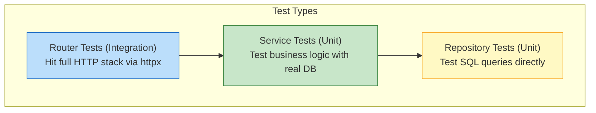
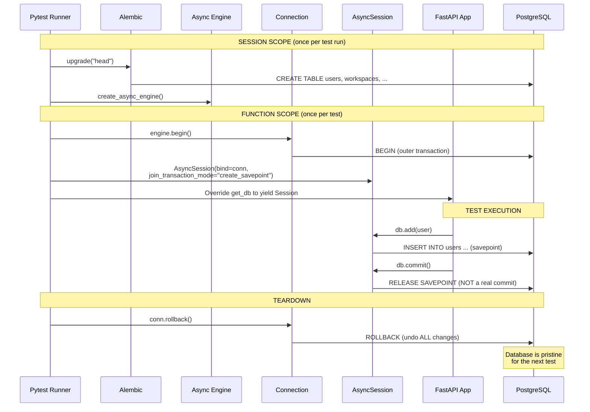
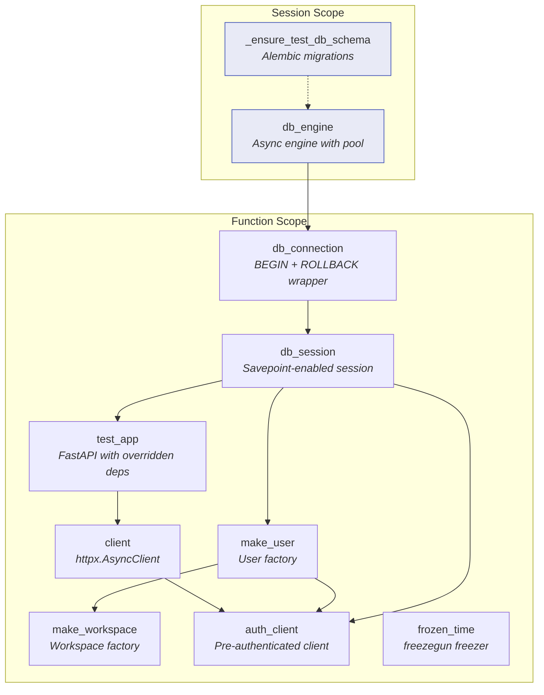
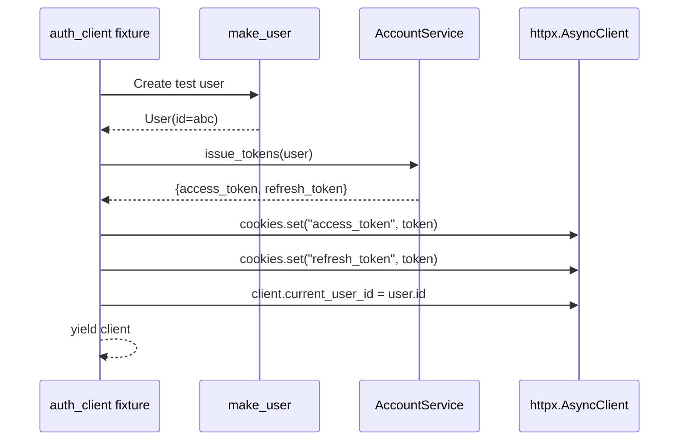
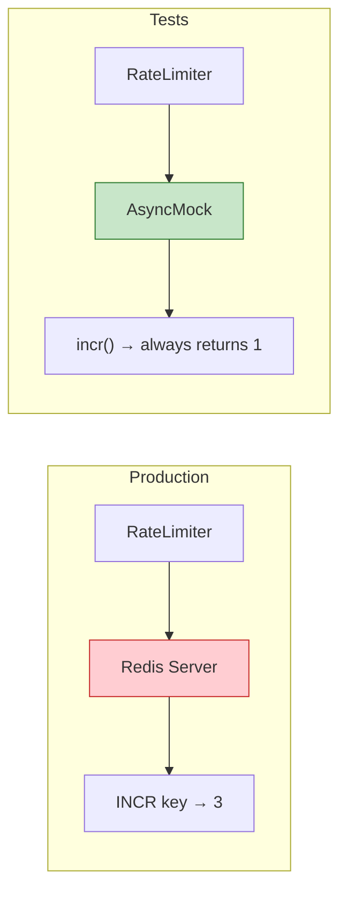
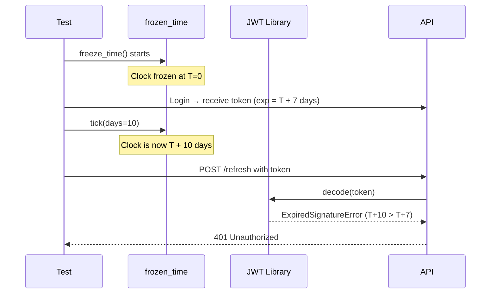

# Testing Architecture — Technical Specification

> **Test Directory**: `backend/tests/`  
> **Framework**: pytest + pytest-asyncio  
> **Total Tests**: 51 (all passing)

---

## Table of Contents

1. [Testing Philosophy](#1-testing-philosophy)
2. [Test Infrastructure](#2-test-infrastructure)
3. [Fixture Architecture](#3-fixture-architecture)
4. [Mocking Strategy](#4-mocking-strategy)
5. [Test Organization](#5-test-organization)
6. [Running Tests](#6-running-tests)

---

## 1. Testing Philosophy

The test suite follows three core principles:

| Principle | Implementation |
|-----------|---------------|
| **Speed** | Database savepoints eliminate table creation/destruction overhead |
| **Isolation** | Every test runs in its own transaction that is rolled back after completion |
| **Realism** | Tests hit the real FastAPI app via `httpx.AsyncClient`, exercising middleware, dependencies, and exception handlers |

### Test Pyramid



- **Repository Tests**: Verify that SQL queries return the correct data and handle edge cases (duplicates, missing records).
- **Service Tests**: Verify business rules like password verification, token rotation, and the owner invariant.
- **Router Tests**: Verify the full HTTP lifecycle — request parsing, status codes, response formatting, cookie handling, and error responses.

---

## 2. Test Infrastructure

### 2.1 Database Savepoint Lifecycle

The key innovation in this test suite is the use of **nested transactions (savepoints)** to achieve per-test isolation without the cost of re-creating the database schema.



### 2.2 Why Savepoints Instead of Truncation?

| Approach | Speed | Isolation | Complexity |
|----------|:-----:|:---------:|:----------:|
| **DROP/CREATE tables per test** | ❌ Very slow | ✅ Perfect | Low |
| **TRUNCATE tables per test** | ⚠️ Moderate | ✅ Perfect | Low |
| **Savepoint + Rollback** | ✅ Very fast | ✅ Perfect | Moderate |

Savepoints are the fastest approach because:
1. Schema creation happens **once** (session scope)
2. Each test wraps all operations in a transaction
3. Rollback undoes everything instantly (no disk I/O)
4. The next test starts with a completely clean database

### 2.3 Configuration Isolation

The test suite uses a separate `.env.test` file with a dedicated test database:

```
# .env.test
DATABASE_URL=postgresql+psycopg://postgres:postgres@db:5432/docrag_test
```

This is loaded by setting `os.environ["ENV_FILE"] = ".env.test"` at the top of `conftest.py`, before any settings are imported.

---

## 3. Fixture Architecture

All fixtures are defined in `tests/conftest.py` and compose into a dependency graph:



### 3.1 Fixture Specifications

#### `db_engine` (Session Scope)
Creates a single async engine for the entire test session. Disposed after all tests complete.

| Config | Value |
|--------|-------|
| `pool_size` | 5 |
| `max_overflow` | 10 |

#### `db_connection` (Function Scope)
Opens a new database connection and starts an outer transaction. After the test function completes, the connection is rolled back, discarding all data written during the test.

#### `db_session` (Function Scope)
Creates an `AsyncSession` bound to the outer transaction with `join_transaction_mode="create_savepoint"`. This is the critical setting that makes `db.commit()` create a savepoint instead of a real commit.

#### `test_app` (Function Scope)
Overrides FastAPI's `get_db` dependency to yield the test session. Also injects a mocked Redis instance into `app.state.redis`.

#### `client` (Function Scope)
An `httpx.AsyncClient` that talks directly to the FastAPI ASGI app via `ASGITransport`. No real HTTP server is started — requests are processed in-memory.

#### `make_user` (Function Scope)
Factory function that creates a user directly in the database, bypassing the HTTP registration endpoint.

```python
# Basic usage
user = await make_user()

# With overrides
user = await make_user(
    email="custom@example.com",
    full_name="Custom User",
    password="MyPassword123",  # Auto-hashed by the fixture
    is_active=False
)
```

**Key behaviors:**
- Passwords are automatically bcrypt-hashed before insertion
- `is_active` is handled via a post-creation model attribute update
- Default email: `test@example.com` (override to avoid conflicts when creating multiple users)

#### `make_workspace` (Function Scope)
Factory function that creates a workspace and assigns an owner.

```python
# Auto-creates a new owner
workspace, owner = await make_workspace()

# Uses an existing user as owner
workspace, owner = await make_workspace(owner=existing_user)
```

#### `auth_client` (Function Scope)
An `httpx.AsyncClient` pre-loaded with valid JWT cookies for a newly created test user.



#### `frozen_time` (Function Scope)
Wraps the test in `freezegun.freeze_time()`, allowing time manipulation for token expiration testing.

---

## 4. Mocking Strategy

### 4.1 Redis Mock

Redis is mocked to avoid requiring a live Redis instance in CI environments.



The mock is configured to:
- `redis.incr()` → returns `1` (always under the rate limit)
- `redis.expire()` → returns `True` (no-op)

This allows the rate limiting code path to execute completely without actually connecting to Redis.

### 4.2 Time Mock (freezegun)



---

## 5. Test Organization

```
tests/
├── conftest.py                    # Shared fixtures (engine, session, factories)
├── accounts/
│   ├── __init__.py
│   ├── test_repository.py         # UserRepository unit tests
│   ├── test_service.py            # AccountService unit tests
│   └── test_router.py             # HTTP endpoint integration tests
└── workspaces/
    ├── __init__.py
    ├── test_repository.py         # WorkspaceRepository unit tests
    ├── test_service.py            # WorkspaceService unit tests
    └── test_router.py             # HTTP endpoint integration tests
```

### Test Coverage Summary

| Module | Layer | Tests | Key Scenarios |
|--------|-------|:-----:|---------------|
| Accounts | Repository | 3 | Create user, get by email, get by ID |
| Accounts | Service | 5 | Register, login, wrong password, duplicate email, disabled account |
| Accounts | Router | 10 | Register, login, /me, logout, refresh, token expiry, token reuse |
| Workspaces | Repository | 5 | Create workspace, add/remove member, list members, count owners |
| Workspaces | Service | 8 | Create, invite, update role, remove, owner invariant, permission denied |
| Workspaces | Router | 12 | Create, list, get, invite, update role, remove, access control |

---

## 6. Running Tests

### Commands

```bash
# Run all tests
PYTHONPATH=. pytest tests/ -v

# Run a specific module
PYTHONPATH=. pytest tests/accounts -v
PYTHONPATH=. pytest tests/workspaces -v

# Run a specific test file
PYTHONPATH=. pytest tests/accounts/test_router.py -v

# Run a specific test function
PYTHONPATH=. pytest tests/accounts/test_router.py::test_login_success -v

# Run tests matching a keyword
PYTHONPATH=. pytest tests/ -v -k "refresh"
```

> **Note:** `PYTHONPATH=.` is required because the project is not installed as a package. This adds the current directory to Python's module search path, allowing `from app.core.config import ...` imports to resolve.
