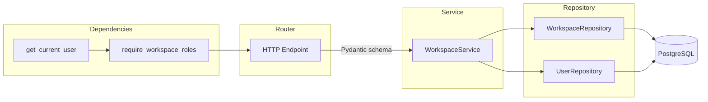
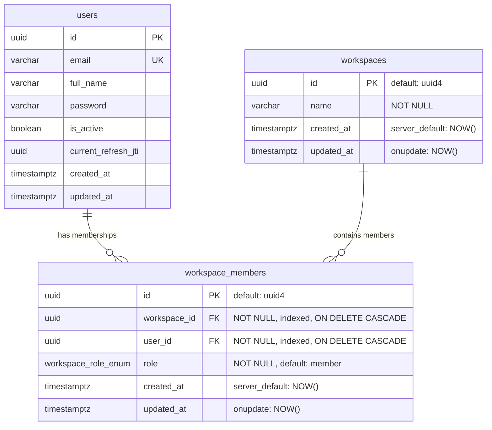
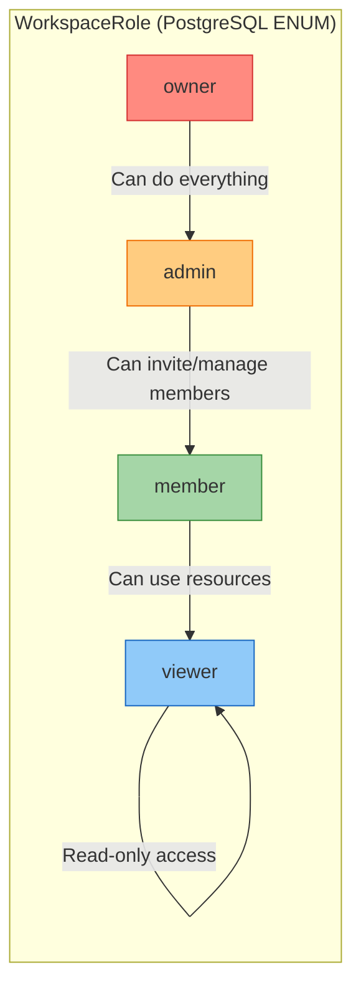
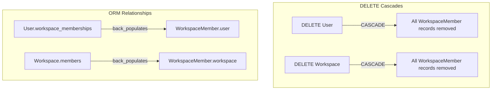
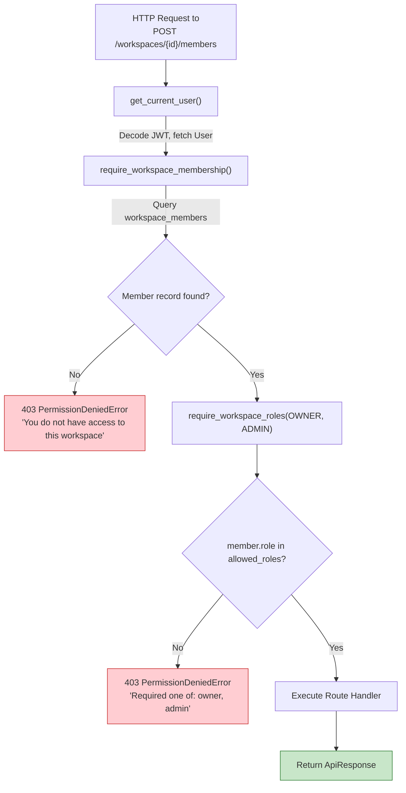
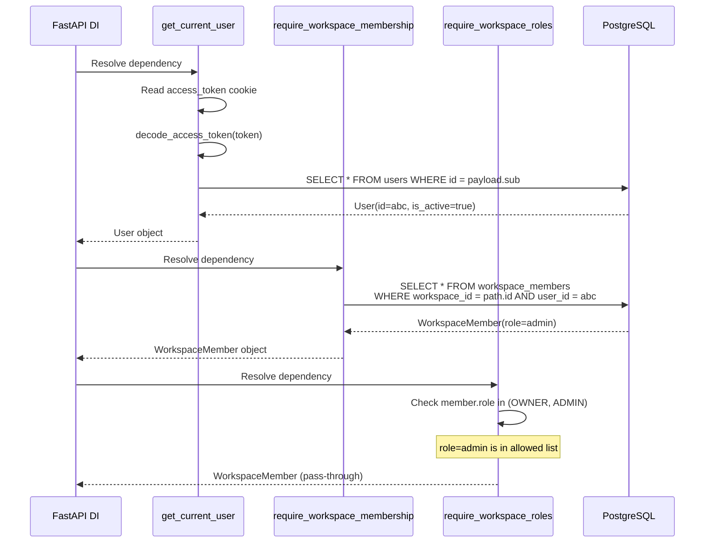
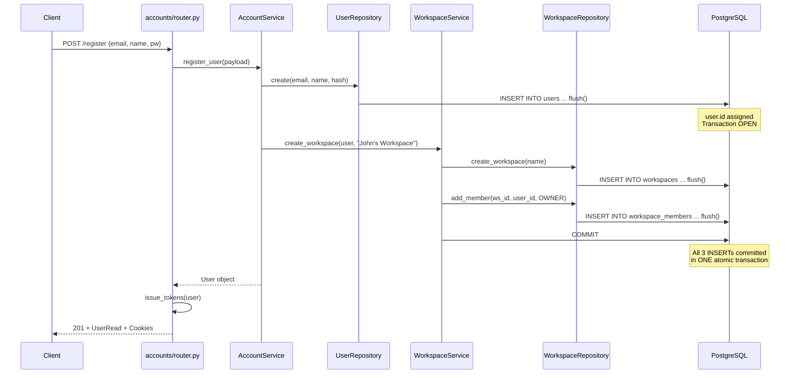
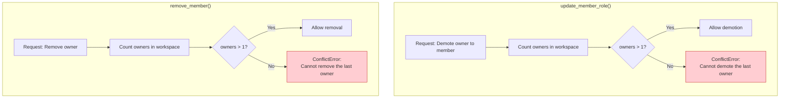

# Workspaces Module — Technical Specification

> **Module Path**: `app/modules/workspaces/`  
> **API Prefix**: `/api/v1/workspaces`  
> **Responsibilities**: Multi-tenancy, organizational grouping, role-based access control

---

## Table of Contents

1. [Module Overview](#1-module-overview)
2. [Data Model](#2-data-model)
3. [Role-Based Access Control (RBAC)](#3-role-based-access-control-rbac)
4. [Auto-Provisioning Workflow](#4-auto-provisioning-workflow)
5. [Business Rules & Invariants](#5-business-rules--invariants)
6. [API Reference](#6-api-reference)
7. [Error Catalogue](#7-error-catalogue)

---

## 1. Module Overview

The workspaces module introduces multi-tenancy — isolated environments where users collaborate on shared resources (documents, chat sessions, etc.). Every downstream feature (document uploads, RAG queries) will be scoped to a workspace.

### Module Structure

```
app/modules/workspaces/
├── models.py          # Workspace, WorkspaceMember, WorkspaceRole
├── schemas.py         # Request/response Pydantic schemas
├── repository.py      # WorkspaceRepository (database queries)
├── service.py         # WorkspaceService (business logic + invariants)
├── router.py          # HTTP endpoint definitions
└── dependencies.py    # RBAC dependencies (membership + role checks)
```

### Internal Data Flow



---

## 2. Data Model

### 2.1 Entity-Relationship Diagram



### 2.2 `workspaces` Table

| Column | Type | Constraints | Description |
|--------|------|-------------|-------------|
| `id` | `UUID` | PK, default `uuid4` | Globally unique workspace identifier |
| `name` | `VARCHAR` | NOT NULL | Display name for the workspace |
| `created_at` | `TIMESTAMPTZ` | NOT NULL, server_default | Creation timestamp |
| `updated_at` | `TIMESTAMPTZ` | NOT NULL, onupdate | Last modification timestamp |

### 2.3 `workspace_members` Table (Association)

| Column | Type | Constraints | Description |
|--------|------|-------------|-------------|
| `id` | `UUID` | PK, default `uuid4` | Member record identifier |
| `workspace_id` | `UUID` | FK → `workspaces.id`, ON DELETE CASCADE, indexed | Target workspace |
| `user_id` | `UUID` | FK → `users.id`, ON DELETE CASCADE, indexed | Target user |
| `role` | `workspace_role_enum` | NOT NULL, default `member` | PostgreSQL native ENUM |
| `created_at` | `TIMESTAMPTZ` | NOT NULL, server_default | When the user joined |
| `updated_at` | `TIMESTAMPTZ` | NOT NULL, onupdate | Last role change timestamp |

**Unique Constraint:** `uq_workspace_member(workspace_id, user_id)` — A user can only be a member of a workspace once.

### 2.4 WorkspaceRole Enum

The role is stored as a PostgreSQL native ENUM type (`workspace_role_enum`), not a string column. This enforces valid values at the database level.



### 2.5 Relationships & Cascade Behavior



The `WorkspaceMember.user` relationship uses `lazy="joined"`, which means whenever a workspace member is queried, the associated User record is eagerly loaded in the same SQL query via a JOIN. This avoids the N+1 query problem when listing members.

---

## 3. Role-Based Access Control (RBAC)

### 3.1 Permission Matrix

| Action | Owner | Admin | Member | Viewer |
|--------|:-----:|:-----:|:------:|:------:|
| View workspace details | ✅ | ✅ | ✅ | ✅ |
| List workspace members | ✅ | ✅ | ✅ | ✅ |
| Upload documents (future) | ✅ | ✅ | ✅ | ❌ |
| Invite members | ✅ | ✅ | ❌ | ❌ |
| Update member roles | ✅ | ✅ | ❌ | ❌ |
| Remove members | ✅ | ✅ | ❌ | ❌ |
| Delete workspace (future) | ✅ | ❌ | ❌ | ❌ |

### 3.2 RBAC Enforcement Architecture

RBAC is implemented as composable FastAPI dependencies, not hardcoded in route handlers. This keeps routes clean and makes the permission logic reusable.



### 3.3 Dependency Chain Detail



---

## 4. Auto-Provisioning Workflow

When a new user registers, the system automatically creates a personal workspace for them. This eliminates the need for an explicit "Create Workspace" onboarding step.



**Atomicity guarantee:** Because all three INSERTs (user, workspace, membership) happen within the same SQLAlchemy session and are committed in a single `COMMIT`, a failure at any step causes a complete rollback. No orphaned data is possible.

---

## 5. Business Rules & Invariants

### 5.1 Owner Invariant

Every workspace must have at least one owner at all times. This is enforced in two places:



### 5.2 Unique Membership Constraint

The database-level unique constraint `uq_workspace_member(workspace_id, user_id)` prevents a user from being invited to the same workspace twice. If violated, the Service catches the `IntegrityError` and raises a `ConflictError`.

---

## 6. API Reference

All endpoints require a valid `access_token` cookie unless otherwise noted.

### `POST /api/v1/workspaces`

Create a new workspace. The authenticated user becomes the owner.

**Request**

| Field | Type | Constraints | Required |
|-------|------|-------------|----------|
| `name` | `str` | min: 1, max: 100 chars | Yes |

```json
{ "name": "Engineering Team" }
```

**Response** — `201 Created`

```json
{
  "success": true,
  "message": "Workspace created successfully",
  "data": {
    "id": "f47ac10b-58cc-4372-a567-0e02b2c3d479",
    "name": "Engineering Team",
    "created_at": "2026-07-23T15:00:00+00:00",
    "updated_at": "2026-07-23T15:00:00+00:00"
  }
}
```

---

### `GET /api/v1/workspaces`

List all workspaces the authenticated user belongs to. Results ordered by `created_at DESC` (newest first).

**Response** — `200 OK`

```json
{
  "success": true,
  "message": "Workspaces retrieved successfully",
  "data": [
    {
      "id": "f47ac10b-...",
      "name": "Engineering Team",
      "created_at": "2026-07-23T15:00:00+00:00",
      "updated_at": "2026-07-23T15:00:00+00:00"
    }
  ]
}
```

---

### `GET /api/v1/workspaces/{workspace_id}`

Get details of a specific workspace.

| Requirement | Detail |
|-------------|--------|
| **Path Parameter** | `workspace_id` (`uuid.UUID`) |
| **Required Role** | Any member of the workspace |

**Response** — `200 OK`

Returns a single `WorkspaceRead` object (same shape as the list items above).

---

### `GET /api/v1/workspaces/{workspace_id}/members`

List all members of a workspace with their user details.

| Requirement | Detail |
|-------------|--------|
| **Path Parameter** | `workspace_id` (`uuid.UUID`) |
| **Required Role** | Any member of the workspace |

**Response** — `200 OK`

```json
{
  "success": true,
  "message": "Workspace members retrieved successfully",
  "data": [
    {
      "id": "e32ac10b-58cc-4372-a567-0e02b2c3d479",
      "workspace_id": "f47ac10b-58cc-4372-a567-0e02b2c3d479",
      "user_id": "550e8400-e29b-41d4-a716-446655440000",
      "role": "owner",
      "email": "john@example.com",
      "full_name": "John Doe",
      "created_at": "2026-07-23T15:00:00+00:00"
    }
  ]
}
```

The `email` and `full_name` fields come from the eagerly-loaded `User` relationship (`lazy="joined"`).

---

### `POST /api/v1/workspaces/{workspace_id}/members`

Invite an existing user to the workspace by their email address.

| Requirement | Detail |
|-------------|--------|
| **Path Parameter** | `workspace_id` (`uuid.UUID`) |
| **Required Role** | `owner` or `admin` |

**Request**

| Field | Type | Constraints | Required | Default |
|-------|------|-------------|----------|---------|
| `email` | `EmailStr` | Must be a registered user | Yes | — |
| `role` | `WorkspaceRole` | `owner`, `admin`, `member`, `viewer` | No | `member` |

```json
{
  "email": "colleague@example.com",
  "role": "member"
}
```

**Response** — `200 OK`

Returns a `WorkspaceMemberResponse` with the newly invited member's details.

**Error Responses:**

| Status | Condition | Message |
|--------|-----------|---------|
| 403 | User is not `owner` or `admin` | `"Required one of: owner, admin"` |
| 404 | Email not found in user database | `"User with email ... not found"` |
| 409 | User already a member | `"User is already a member of this workspace"` |

---

### `PATCH /api/v1/workspaces/{workspace_id}/members/{member_id}`

Update an existing member's role.

| Requirement | Detail |
|-------------|--------|
| **Path Parameters** | `workspace_id` (`uuid.UUID`), `member_id` (`uuid.UUID`) |
| **Required Role** | `owner` or `admin` |

**Request**

| Field | Type | Constraints | Required |
|-------|------|-------------|----------|
| `role` | `WorkspaceRole` | `owner`, `admin`, `member`, `viewer` | Yes |

```json
{ "role": "admin" }
```

**Error Responses:**

| Status | Condition | Message |
|--------|-----------|---------|
| 404 | Member not found in workspace | `"Workspace member not found"` |
| 409 | Demoting the only owner | `"Cannot demote the last owner of a workspace"` |

---

### `DELETE /api/v1/workspaces/{workspace_id}/members/{member_id}`

Remove a member from the workspace entirely.

| Requirement | Detail |
|-------------|--------|
| **Path Parameters** | `workspace_id` (`uuid.UUID`), `member_id` (`uuid.UUID`) |
| **Required Role** | `owner` or `admin` |

**Response** — `200 OK`

```json
{
  "success": true,
  "message": "Member removed successfully",
  "data": null
}
```

**Error Responses:**

| Status | Condition | Message |
|--------|-----------|---------|
| 404 | Member not found | `"Workspace member not found"` |
| 409 | Removing the only owner | `"Cannot remove the last owner of a workspace"` |

---

## 7. Error Catalogue

| Error Class | HTTP Status | When Raised | Example Message |
|------------|-------------|-------------|-----------------|
| `PermissionDeniedError` | 403 | Non-member tries to access workspace | `"You do not have access to this workspace"` |
| `PermissionDeniedError` | 403 | Member lacks required role | `"Required one of: owner, admin"` |
| `NotFoundError` | 404 | Workspace or member not found | `"Workspace not found"` |
| `ConflictError` | 409 | User already a member | `"User is already a member of this workspace"` |
| `ConflictError` | 409 | Last owner demotion/removal | `"Cannot demote the last owner of a workspace"` |
